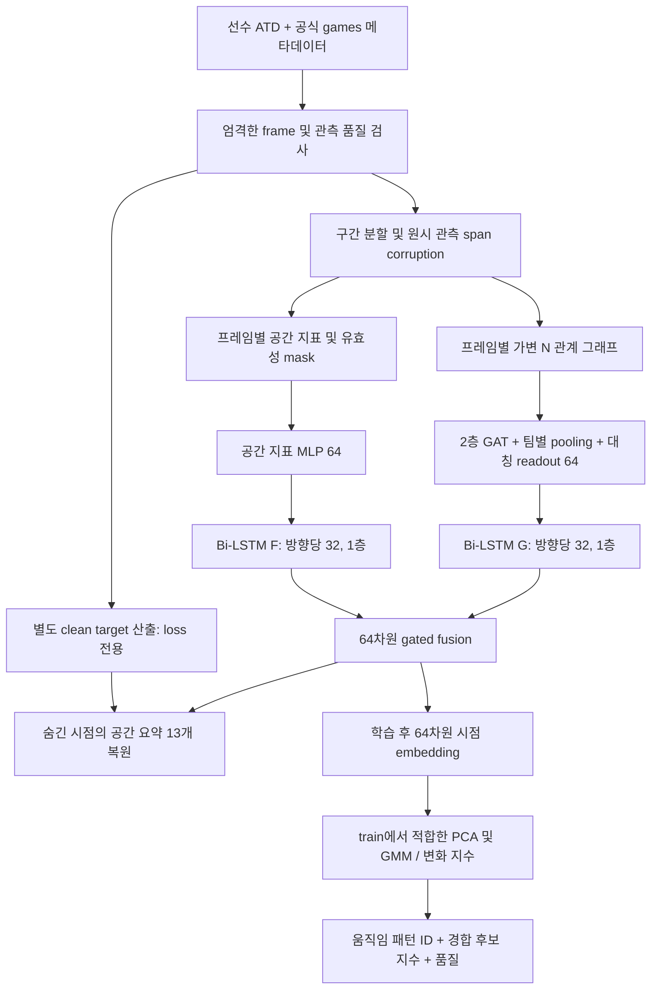

# MTAH 2027 모델 구현 계획

작성일: 2026-11-09. 이 문서는 전체 A/B/C 설계와 현재 구현 상태를 구분한다. 실제 외부 코드의 근거·접근 제한·기존 코드 감사는 [연구 결과](CODEX_RESEARCH_OUTPUT.md)에 정리했다.

후속 1단계 개발에서는 데이터 무결성·공간 관계·대칭24개/ordered H/A 구조·비학습 지수·frame-local corruption 계약을 구현했다. 당시 실행과 테스트 결과는 [PHASE1_DATA_RELATIONS.md](PHASE1_DATA_RELATIONS.md)를 따른다. 1단계 당시에는 윈도우와 신경망이 모두 미구현이었다.

**시계열 단계 완료:** 151프레임 WindowDataset, 반별 시간 블록 분할, raw-first joint masking, Train-only scaler/imputer, 별도 clean targets와 추론 padding까지 구현·검증했다. [PHASE2_TEMPORAL_DATA.md](PHASE2_TEMPORAL_DATA.md)에 당시 결과를 기록했다.

**현재 상태 — 사용자 요청의 4단계:** Spatial Feature Encoder + Bi-LSTM **A 모델**을 구현하고 로컬 MPS 학습·세 기준 모델 비교·158,857개 중심 임베딩 추출을 완료했다. [PHASE4_MODEL_A.md](PHASE4_MODEL_A.md)에 실제 파일·116개 합성 테스트·실험 범위를 기록했다. 이번 실험에서는 선형 보간이 A 모델보다 우수했다. B 모델(GNN), C 모델(fusion), 군집화·경합 분류기·점유 decoder는 구현하지 않았다. 아래 B/C 설명은 여전히 후속 설계다.

**A 모델 후속 단회 진단 완료:** [A_MODEL_DIAGNOSTIC.md](A_MODEL_DIAGNOSTIC.md)에125개 합성 테스트, token/추가 학습/혼합 mask/작은 Temporal의 Validation-only 비교, Train-fitted PCA 및 품질·scale 진단을 기록했다. 버그는 발견하지 않았고, mixed-mask가 긴 복원을 개선했으나 짧은 복원을 악화시켜 기존 A12 checkpoint를 동결 유지한다. 추가 학습 A20은 학습량을 맞춘 대조군으로 별도 보관한다. cluster fraction의 작은 IQR로 손실이 편중되지만 이번에는 scale/weight를 재튜닝하지 않았다. B는 아직 구현하지 않았다.

## 1. 연구 목표와 성공의 범위

이번 모델은 선수 좌표만으로 관계·구조의 시간 표현을 학습하고 경합 **후보**를 찾는다. 첫 버전에서 실제 경합 확률, controlled possession 정답, H/A/D 완성을 약속하지 않는다.

검증할 가설은 다음과 같다.

1. 상대 거리 분포와 팀 응집도의 전후 변화가 단일 프레임 근접 지표보다 유용한 시간 표현을 만드는가?
2. raw graph와 engineered geometry의 결합이 같은 자기지도 목표에서 각각의 단일 스트림보다 유리한가?
3. 학습된 표현이 선수 순열·제한적인 dropout·동일 장면의 H/A 교환에 안정적인가?
4. 변화 패턴이 추후 점유 유지/전환 판단에 추가 근거가 될 수 있는가? **현재 라벨로는 4번을 실제 점유 정확도까지 검증할 수 없다.**

공개 GT를 모델 선택에 쓰지 않는다. 경기 장면을 사람이 보고 후보의 정답을 만들거나 군집을 정답 클래스로 지정하지 않는다. 분석용 그래프를 살펴보는 것과 그 관찰을 특정 프레임 label·threshold 보정에 사용하는 것을 구분한다.

## 2. 제안하는 첫 모델의 전체 구조



두 개의 Bi-LSTM은 각각 다른 공간 표현을 처리한다. Ball Radar의 “PPC가 BTR을 감독하는 계층”을 그대로 사용하는 모델이 아니다. GNN→pooling이 시간 인코더 **앞**에 있으므로 선수 ID를 시간축으로 연결하지 않는다.

기본 context는 25fps의 `T=151`, 중심 75, 전후 3초다. 미래 정보를 쓰는 **오프라인** 모델이며 실시간 사용에는 별도 causal 설계가 필요하다. 첫 데이터 버전은 속도·가속도·볼·Smart Tagging·broadcast를 쓰지 않는다.

## 3. 데이터 계약과 구간 정책

### 3.1 선수 관측 계약

공식 [games.py](../games.py), [DATA.md](../DATA.md), [load_atd.py](../starter/load_atd.py)를 기준으로 한다.

| 필드 | shape/type | 계약 |
|---|---|---|
| `frame` | int | `ATD frame_id−1`, 0-based, 유일·엄격 증가 |
| `period` | 0/1/2 | 공식 half blocks; 0은 학습 context에서 제외 |
| `xy_m` | float32 `[N_t,2]` | 관측 선수만, pitch 105.3×68m |
| `team` | int `[N_t]` | 0=H, 1=A, XML/공식 팀 순서로 결정 |
| `source_slot` | int `[N_t]` | QA 전용. 임베딩·정체성·개인 궤적 loss에 전달 금지 |
| `observation_flags` | `[N_t,…]` | finite/bounds/duplicate 의심 등; 진단과 loss-valid 분리 |
| `quality` | 구조체 | 관측 수·의심 관측·결측 양상, 정답 신뢰도 보증 아님 |

TXT에 볼 필드가 같은 record에 있어도 **선수 필드만 수치 파싱**한다. 볼·SmartTag를 담을 key 자체를 dataset/model schema에 만들지 않는다. 경합 전용 실행은 이들 파일을 요구하지 않아야 한다. 기존 SmartTag 기반 alignment CSV·X mask·tagged zone 산출물도 의존하지 않는다.

원본은 보존한다. 비정상 좌표는 flag 후 유효성 정책에 따라 모델 입력에서 제외하되 원본 값을 고치지 않는다. 경기장 밖 실제 선수와 오검출을 bounds 하나로 확정할 수 없으므로 허용 margin과 처리 정책을 사전 설정하고 기록한다. 근접 duplicate 의심도 실제 두 선수일 수 있어 자동 합치기·삭제를 기본으로 하지 않는다. 민감도 실험을 분리한다. 동일 coordinate 중복을 count만으로 보정했다고 주장하지 않는다.

프레임 유일성 검사는 기대 ID와 매 record를 대조한다. record 수와 양끝 번호가 맞는 것만으로 내부 순서·누락·중복이 없다고 보지 않는다. 전체 기대 길이·슬롯 수·팀 코드 유효성도 확인한다.

### 3.2 시간 구간과 경계

* 전반: `11185..90651`, 후반: `110808..190197` (양끝 포함).
* 후반 시작을 이전 SmartTag 기반 추정 킥오프로 교체하지 않는다.
* period 밖·반 사이·원시 기록 누락을 가로지르는 window를 만들지 않는다.
* 자연 선수 dropout은 행을 지우거나 시간축을 압축하지 않고 observation mask로 남긴다.
* 학습에서는 완전한 T window 중심을 우선 사용한다. 구간 양끝도 추론 결과가 필요하므로 이후에는 해당 반 안의 context만 쓰고 바깥을 explicit temporal padding한다. 다른 반·pregame을 채우지 않는다.
* severe dropout을 학습 loss에서 제외하더라도 원래 frame 번호를 유지한다. 추후 제출의 저품질 구간에는 보수적인 owner 유지/X 정책을 별도로 정의한다.

## 4. Graph stream: 관계를 먼저 요약한다

### 4.1 토폴로지와 속성

노드는 현재 프레임에 유효하게 관측된 선수다. 소스 슬롯 46개를 가짜 선수 노드로 항상 채우지 않는다. 초기 node input은 `[x/L,y/W]` **2차원**이다. 팀 소속은 same/opposite 관계와 pooling에 사용하며, 홈/원정 고유 임베딩을 넣지 않는다.

첫 sparse graph 제안:

* 같은 팀 kNN, `k=min(3,n_team−1)`, 양방향화.
* 상대 팀 거리 10m 이내 모든 쌍과 3/5m 관계 flag. 각 관측 선수의 최근접 상대도 추가해 먼 팀 맥락이 완전히 끊기지 않게 한다.
* 거리 동률을 배열 index로 자르지 않는다. k번째 거리와 같은 동률을 전부 포함하는 등 순열에 안전한 정책을 사용한다.
* 동일 엣지 중복은 제거하고 self-loop는 명시적으로 정의한다.
* node 수가 작으므로 완전 연결 GAT도 비교한다. 이것이 원본 PathCRF와 더 가까운 토폴로지다.
* **48구역 안으로 쌍을 제한하지 않는다.** 구역 경계 양쪽에서 1m인 두 선수가 빠지지 않아야 한다.

제안 edge attr은 8차원:

```text
[dx/L, dy/W, d/10m, same_team, opposite_team,
 opposite_team & d<=3m, opposite_team & d<=5m, opposite_team & d<=10m]
```

방향을 반대로 하면 dx/dy 부호가 바뀌며 나머지는 같다. d/10은 10m에서 1이라는 스케일 기준이지 clipping 명령이 아니다. 먼 fallback edge도 거리를 보존한다. self-loop는 dx=dy=d=0, same_team=1 등 명시한 값을 넣는다. PyG의 self-loop edge-attr 자동 평균 채우기를 거리 의미로 오해하지 않도록 자동 생성과 중복 사용하지 않는다.

### 4.2 Encoder와 불변성

GAT 두 층, heads=4, 층당 output=32, `concat=False`, LayerNorm/ELU를 초기값으로 제안한다. 팀별 같은 가중치를 쓰며 노드→팀 평균 `z_H,z_A∈R32`를 얻는다. scene readout:

```text
s_t = [z_H + z_A, abs(z_H - z_A), max_over_all_valid_nodes(h)]  # 96
z_graph[t] = LayerNorm(Linear96→64(s_t))
```

팀 중 하나가 비면 mask와 별도 empty 처리로 NaN을 막고 confidence를 낮춘다. 현재 관측이 없는 것과 원래 공간적으로 비어 있는 것은 구분한다. 학습용 artificial hidden frame은 이 과정을 아예 실행하지 않고 고정된 **frame mask token 64**로 대체한다. clean graph의 node 수·edge 수·실측 quality를 숨긴 시점 입력에 남기지 않는다.

독립적인 프레임별 선수 순열에도 같은 embedding을 내야 한다. 팀 코드를 맞바꾸면 z_H/z_A만 교환되고 위 대칭 readout은 같아야 한다. contest 모델은 이 불변성을 요구하지만 H/A 출력은 팀 교환 시 교환되어야 한다. 이를 위해 ordered team 통계·z_H/z_A는 별도 진단 인터페이스로 보관하고 **추후 owner evidence 모델**에서 사용한다. 대칭 contest embedding만으로 어느 팀이 이득을 얻었는지 복원할 수 있다고 주장하지 않는다.

GAT attention weight는 모델의 가중 집계 계수다. 볼 위치나 실제 경합 위치의 정답 heatmap으로 해석하지 않는다.

### 4.3 Set 대안

대안은 mask-aware Set Transformer 또는 더 작은 DeepSets다. Set은 토폴로지 선택 부담이 적고 all-player context를 읽지만 좌표 거리·팀 관계의 inductive bias가 약할 수 있다. GAT은 관계를 명시하는 대신 radius/kNN 설정에 의존한다. N이 많지 않아 ISAB의 큰 N 계산 절감이 핵심 장점은 아니다.

원본 Ball Radar의 padding mask 없는 128차원 ST를 복사하지 않는다. 비교할 때는 동일 temporal context·목표·데이터 분할·관측 정책과 가능한 유사 parameter budget을 사용한다.

## 5. Engineered stream과 자기지도 target

### 5.1 첫 실험 feature schema: 대칭 24개

기존 39개를 그대로 신경망 입력에 넣지 않는다. 첫 SSL 모델은 **프레임 안에서만 계산되는** 지표를 사용해 전후 차분 누출을 줄인다. 시간 변화는 우선 Bi-LSTM이 학습한다. 기존 39개는 비교용 진단으로 보존하고 새 schema/version을 분리한다.

거리행렬 D는 H×A 미터 거리다. `diag=sqrt(L²+W²)`이며 아래 범위 정규화는 손실의 train-only scaling을 대체하지 않는다. width/length는 새 버전에서 P90−P10을 사용하고 min/max 결과는 별도 진단으로 유지한다.

| 번호 | feature/복원 target | 정의 |
|---|---|---|
| 1–3 | cross density 3/5/10m | `count(D<=r)/(nH*nA)` |
| 4 | minimum cross distance | `min(D)/diag` |
| 5 | symmetric mean nearest opponent | 양 팀 각 선수의 최근접 상대거리를 합쳐 평균/diag |
| 6 | largest bipartite component fraction | 최대 H-A 3m component 인원/(nH+nA) |
| 7 | centroid gap | 두 팀 중심거리/diag |
| 8–9 | robust width sum/abs diff | 합/(2W), 절댓차/W |
| 10–11 | robust length sum/abs diff | 합/(2L), 절댓차/L |
| 12–13 | radius sum/abs diff | 팀 평균 중심거리의 합/(2diag), 절댓차/diag |
| 14 | global team mix | `2min(nH,nA)/(nH+nA)` |
| 15–17 | pair count 3/5/10m | 각각 count/121; 121은 정상11×11 기준 스케일, 상한 보장 아님 |
| 18 | component reference count | 최대 component 인원/22; 중복 때 1 초과 가능 |
| 19–20 | team-centroid midpoint | `(cH+cA)/2`의 xy/L,W |
| 21–22 | bbox area sum/abs diff | 원시 max/min bbox 면적 합/(2LW), 절댓차/LW |
| 23–24 | within-team nearest distance | 팀별 평균 최근접 동료거리의 합/(2diag), 절댓차/diag |

**복원 target은 1–13의 K=13개**로 한정한다. 개인 ID 정렬·player matching 없이 계산되는 집합 요약이다. feature와 target 정의가 겹치므로 목표는 geometry를 시간 문맥으로 복원하는 것이며, 축구 경합 의미를 직접 학습하는 손실은 아니다.

각 feature마다 valid mask를 둔다. 예를 들어 nH 또는 nA=0이면 cross pair의 0을 관측된 비접촉 target으로 쓰지 않는다. 동료 거리에는 팀당 2명 이상, 구조 통계에는 사전 정의한 최소 관측 정책이 필요하다. 저인원 radius=0을 정상적으로 좁은 팀으로 간주하지 않는다. quality 기준은 GT로 정하지 않는다.

### 5.2 품질과 스케일

관측 시점에 입력할 symmetric quality 4개 예시는 `[min(nH,nA)/11, max(nH,nA)/11, duplicate_suspect_fraction, out_of_bounds_fraction]`이다. 의심 비율은 자동 QA의 결과이지 오검출 정답 비율이 아니다.

가려지지 않은 시점 input은 `values24 + feature_valid24 + quality4 + artificial_mask_bit1`, 총 **53차원**이다. NaN은 valid mask를 보존한 뒤 scaler 기준값으로 채운다. scaler의 median/IQR·결측 대체·feature 가중치는 train block에서만 fit하고 holdout에는 transform만 한다. 상수 feature의 IQR=0에는 안전한 scale을 사용한다.

MLP는 `53→64→64`, 각 층의 LayerNorm/ELU다. **구현된 A 모델은 이번 사용자 명세에 따라 별도 학습 가능한 mask token을 두지 않는다.** artificial hidden frame은 기존 Dataset의 values/validity/quality=0, artificial bit=1인53차원 입력을 같은 MLP로 처리한다. 최초 설계의 feature mask token64와 달라 A 파라미터는64개 줄었다. clean quality는 hidden target의 loss weight 계산에만 쓴다. 모델이 hidden frame의 선수 수를 보고 복원 정답을 맞히는 통로를 차단한다.

### 5.3 선수 이동/가속도는 왜 다음 단계인가

ATD scalar speed가 있더라도 방향벡터를 주지 않으며 slot별 xy 차분은 ID swap에 취약하다. 관측 집합의 centroid 변화도 missing composition 변화의 영향을 받는다. 첫 버전은 이를 개인 가속도로 부르지 않는다. 이후 train에서만 정의한 품질 조건하에 centroid velocity·거리분포 변화·팀별 구조 변화량을 추가한다.

pre/post 팀 통계는 `H_before→H_after`, `A_before→A_after`로 따로 보고한다. post-event 확장·전진이 실제 점유 획득이라는 해석은 아직 가설이다. 방향 정보가 필요하면 공식/자동 방향 추정의 신뢰도부터 확인하며 홈팀은 항상 +x라는 가정을 하지 않는다.

## 6. Two-Stream Bi-LSTM과 shape

| 제안 인터페이스 | 입력 | 출력 |
|---|---|---|
| `PlayerOnlyReader` | 로컬 ATD 선수 필드 + 공식 metadata | `FrameObservations` iterator, frame/QC |
| `GraphBuilder` | 한 시점 observed xy/team | node `[N_t,2]`, edge `[2,E_t]`, attr `[E_t,8]` |
| `SpatialSummaries` | 한 시점 선수 집합 | feature `[24]`, feature_valid `[24]`, target `[13]`, target_valid `[13]`, quality |
| `WindowDataset` | raw frame support + split + corruption seed | graph/feature 입력, loss-only clean target, 세 가지 mask |
| `GraphEncoder` | B×T개 가변 그래프/hidden token | `[B,T,64]` |
| `FeatureEncoder` | visible values/valid/Q, hidden token | `[B,T,64]` |
| `TemporalEncoder` 각 stream | `[B,151,64]` | `[B,151,64]` (양방향32) |
| `Fusion` | graph/feature temporal `[B,T,64]` 각각 | `[B,T,64]` |
| `ReconstructionHead` | fused sequence | predicted summary `[B,T,13]` |
| `PatternDiscoverer` | 가리지 않은 중심 시점 embedding `[M,64]` | pattern ID·responsibility·quality, uncalibrated candidate index |

`WindowDataset`과 데이터 계층은 시계열 단계에서 구현했다. A 모델의 FeatureEncoder/TemporalEncoder/ReconstructionHead는 별도 세 클래스 대신 실제 `model_a.SpatialBiLSTM`의 `spatial/temporal/reconstruction` 하위 모듈로 구현했다. 각 Bi-LSTM은 1층, 방향당 hidden32다. Graph/Fusion/PatternDiscoverer는 아직 제안 이름이다. 후속 초기 fusion은 `g=sigmoid(Linear128→64([hG,hF]))`, `z=LayerNorm(g*hG+(1−g)*hF)`이다. gate 평균·분산과 단일 branch 보조 reconstruction을 기록해 한쪽이 완전히 무시되는지 확인할 계획이다.

본래 자연 결측은 timestep padding이 아니다. artificial mask도 모델이 context로 복원해야 하는 시점이므로 sequence 길이에서 삭제하지 않는다. temporal padding은 다른 반의 정보를 채우지 않도록 처리하고 recurrent state·overlap merge를 fold/half 밖으로 이어가지 않는다.

## 7. 자기지도학습 손실과 누출 방지

### 7.1 최초 목적함수

각 window에서 8–13프레임(약0.32–0.52초)의 span을 무작위 가린다. 이는 초기 설계값이며 최적값이 아니다. 추후 25/50프레임을 별도 난도 실험으로 비교한다. 자연 결측을 새로운 정답으로 합성하지 않는다.

`a[b,t]`=artificial hidden, `o[b,t,k]`=clean target가 관측·정의 가능한지, `q[b,t,k]`=사전 품질 weight, `w[k]`=train에서 고정한 feature weight다. train scaler로 정규화한 clean target s와 예측 p에 대해:

```text
v[b,t,k] = a[b,t] * o[b,t,k] * q[b,t,k] * w[k]
L_mask = sum(v * Huber(p, s)) / max(eps, sum(v))
```

valid target가 하나도 없는 batch는 학습 update에서 제외하고 건수를 기록한다. NaN target에 0을 곱해도 NaN이므로 **loss 전에 sanitize 또는 valid indexing**한다. 주 손실은 fusion reconstruction이고, branch별 같은 target의 보조 loss는 낮은 weight로 실험한다. 이 추가값도 실제 contest label이 아니다.

짧은 마스크의 복원이 잘 되는 이유가 단순 시간 보간일 수 있다. persistence·선형 보간·작은 MLP/TCN baseline과 반드시 비교한다. contrastive loss는 처음부터 넣지 않는다. 도입 시 같은 반의 이웃 window를 negative로 잘못 취급하는 문제와 collapse 검증을 따로 해결한다. 시간순서 판별·clock/half ID 같은 쉬운 우회 단서로 성능을 높이지 않는다.

### 7.2 동시 마스킹만으로 부족한 이유

숨긴 구간이 `[a,b]`이고 기존 ±1초 delta를 미리 계산했다면, visible frame `a−25`의 next delta에 a가 들어가고 `b+25`의 prev delta에 b가 들어간다. hidden 시점의 feature만 가려도 정답이 남는다. 스무딩·보간·centroid·속도·quality·graph adjacency·cached pooled embedding도 같은 문제를 만든다.

처리 순서:

1. split을 원시 시간축에서 확정한다.
2. split별 clean 관측에서 loss-only target를 계산한다.
3. raw 관측의 artificial span을 숨긴다.
4. **가려진 raw에서 모델 입력 그래프/공간 특징을 다시 만든다.** 실제 hidden N·edge 수·실측 target-valid/quality를 모델에 보내지 않는다.
5. temporal 파생 지표를 나중에 도입하면 각 feature의 raw dependency set `D(t,k)`를 기록한다. hidden raw와 교차하는 feature는 추가로 가리거나 해당 view에서 유효하게 재계산한다.
6. smoothing과 interpolation을 clean 전체 경기에서 미리 실행한 뒤 mask하지 않는다. scaler는 Train 고유 관측의 분포에서 별도로 fit한 뒤 고정한다. sample의 hidden 관측으로 window 내부 통계를 재계산하거나 fit/refit하지 않는다. hidden-sentinel 테스트에서는 이 고정 파라미터 아래 입력 관측만 바꾸고 결과가 불변인지 확인한다.

미래 문맥을 쓰는 Bi-LSTM 자체는 이 오프라인 연구에서 허용된 정보다. **가린 시점의 정답을 다른 입력 표현으로 직접 흘리는 것**과 구별한다.

### 7.3 반드시 통과할 누출 테스트

합성 window와 고정 corruption seed를 만들고 hidden raw 좌표를 전부 다른 값으로 바꾼다. 두 경우의 **모든 corrupted model input이 같아야 한다**. clean target와 loss-only quality만 달라질 수 있다.

검사 범위에는 hidden span 바깥 derivative halo, feature-valid bit, hidden node/edge 개수, adjacency·distance cache, count/duplicate/OOB flags, teacher embedding, scaler 상태를 포함한다. 같은 시점 두 스트림 마스크 검사는 필요조건일 뿐 충분조건이 아니다. clean target dict를 그대로 model forward에 전달하는 인터페이스도 금지한다.

## 8. 데이터 분할과 한 경기의 표본 수

겹치는 window를 무작위 train/validation으로 나누지 않는다. 반별 시간순 연속 train/validation/test block을 미리 고정하고, GT를 읽지 않은 상태에서 비율·경계를 설정한다. 비지도 validation은 reconstruction·robustness 기준이며 공인 possession 검증셋이 아니다.

중심 c, 반경75, temporal 전처리 반경 R인 sample의 원시 지원 범위는 `[c−75−R,c+75+R]`다. 서로 다른 fold의 지원 범위가 교차하면 안 된다. 경계에서 양쪽 중심을 `75+R`만큼 버리는 식으로 구현하고 실제 support 교집합이 0인지 assert한다. R=0이면 서로 다른 fold의 가장 가까운 중심 간 차이는 최소151, R=25라면 최소201이 필요하다. 단순히 “75프레임 embargo”라는 이름만으로 안전하다고 보지 않는다.

scaler·imputer·PCA·GMM의 fit은 Train에서만 한다. 비지도 Validation은 모델·설정 선택과 검증에 쓰고 Test는 잠근다. prototype memory·negative queue·recurrent state도 fold를 넘어 공유하지 않는다. 마지막에 전체 경기로 재학습하는 transductive 산출물을 만들면 holdout 실험과 분리해 명시한다.

평가 구간 158,857프레임에서 stride1 완전 window는 158,557개지만 대부분 겹친다. 151프레임 완전 비중첩 window는 전후반 합쳐 **1,051개**뿐이며, 이것도 통계적으로 독립인 1,051개 사건이라는 뜻은 아니다. 경기·팀·카메라·전술 다양성이 없으므로 다른 경기 일반화나 경합 종류별 성능은 측정할 수 없다.

## 9. 비지도 패턴과 경합 후보의 해석

### 9.1 비학습 대조군

3m 교차 밀도, 최대 교차 component 비율, 최소 상대거리의 train ECDF rank를 `r_density,r_component,r_distance`로 만들고 초기 비교 지수를 다음처럼 사전 정의할 수 있다.

```text
candidate_proxy = (r_density + r_component + 1 - r_distance) / 3
```

유효 관측 조건을 통과한 시점에만 계산한다. 사전 고정 3/5/10m 민감도도 함께 보고한다. 값이 0~1이어도 확률이 아니며 지표로 정의한 근접 정도다. global component는 체인 연결로 클 수 있으므로 이후 component diameter/혼합도 같은 보완 지표를 검토한다.

48구역은 비교 가능한 보조 통계/시각화로 남긴다. 경계 독립적인 pair 통계를 학습의 기본으로 한다. zone count·mix·players/m² density·pair density의 단위를 혼동하지 않는다.

### 9.2 학습 후 발견

첫 pattern model은 train embedding에서 PCA(예:8차원 이하)와 GMM(K=2..6 후보)을 적합하고 비지도 기준·seed 안정성으로 선택한다. HDBSCAN은 noise/cluster 수 변동 때문에 후속 대안으로 둔다. cluster membership은 pattern model의 책임도일 뿐 실제 경합 확률이 아니다.

군집별 관계 지표·지속시간·coverage 분포와 위치/반 의존도를 보고한다. 품질 불량/경기장 위치만 묶이는지 확인한다. prototype에 train의 자동 proximity proxy 평균을 연결해 후보 순위를 만들 수 있지만, 이것은 **proxy의 재표현**이며 독립적인 경합 정확도 향상이 아니다. 사람의 경기 장면 판정으로 cluster를 `contest=True`라 이름 붙이지 않는다.

전후 structure change는 matched-QC 조건에서 따로 기록한다. 접근→밀집→이탈의 순서와 팀별 폭/중심/응집도 변화를 요약하되, “경합 이후 확장한 팀이 볼을 얻었다”는 결론은 현재 관측만으로 확정하지 않는다. reconstruction error가 큰 구간도 낯선 움직임·dropout일 수 있어 곧바로 경합으로 취급하지 않는다.

### 9.3 식별 불가능성의 구체적 예

* 두 선수가 가까워져 함께 달리는 좌표는 볼 경합과 볼 없는 마킹에서 같을 수 있다.
* 선수들이 잠시 멈춘 좌표만으로 whistle 후 D와 live 상태 대기를 항상 구별할 수 없다.
* 폭이 넓어진 팀은 점유팀일 수도 있고 카운터를 준비하는 비점유팀일 수도 있다.
* 비지도 cluster의 번호를 바꿔도 학습 likelihood가 같으므로 H/A/D 의미는 자동 고정되지 않는다.

따라서 현재 입력만으로 모든 프레임의 진짜 contest·볼 위치·owner를 유일하게 식별할 수 있다는 주장은 성립하지 않는다. synthetic invariant·reconstruction 검증도 이 의미적 한계를 없애지 않는다.

## 10. A/B/C와 대조 실험

| 실험 | 입력/모델 | 목적 |
|---|---|---|
| Rule | 연속 좌표 proximity/구조 proxy | 해석 가능한 비학습 기준 |
| Interpolation | masked summary의 persistence/선형 보간 | 25fps 관성만으로 얻는 복원 성능 확인 |
| A | feature MLP + Bi-LSTM | 수학적 특징만으로 가능한 범위 |
| B | GAT + invariant pooling + Bi-LSTM | 관계 표현의 추가 효과 |
| C | A+B + gated fusion | 단일 branch 대비 보완 여부 |
| Set | 작은 mask-aware Set readout + 동일 temporal | GAT 토폴로지 선택 영향 |
| TCN | pooled feature + 소형 dilated temporal conv | recurrent 방식 필요성 |

모든 학습 모델은 동일 K=13 target·corruption seed·원시 split·품질 정책을 사용한다. A/B/C 비교 시 feature branch에만 과도한 quality 정보가 들어가는 효과도 ablation으로 분리한다. branch별 param 수 차이와 pooling이 잃는 정보를 보고한다.

TCN 예시는 kernel3, block당 conv2개, dilation1/2/4/8/16이면 receptive field는 `1+2*(3−1)*(1+2+4+8+16)=125`다. Bi-LSTM도 **동일125 context**인 비교를 따로 실행하고 151 context 주 실험과 혼합하지 않는다. causal TCN이면 미래를 사용한 Bi-LSTM과 정보량이 다르므로 noncausal 대칭 버전 또는 causal 모델끼리 비교한다. 이는 Borghesi 구조의 확인된 재현이 아니라 독립적인 소형 대조군이다.

측정할 수 있는 것은 hidden summary MAE/Huber, target-valid coverage, permutation/팀 교환 오차, synthetic dropout 성능, latent collapse/gate 상태, block/seed 군집 안정성, local 실행 시간/메모리다. 시간 block bootstrap을 쓰더라도 동일 경기 안 불확실성일 뿐 경기 간 신뢰구간이 아니다. **contest F1·공식 spellF1 개선은 현재 주장할 수 없다.**

## 11. 모델 규모: A 실측과 B/C 초기 산술 계산

아래는 F=24, Q=4, D=64, h=32, K=13의 규모다. **A는 PyTorch 2.15.0에서 `numel`로37,965개를 확인했다.** 최초 연구 당시 PyTorch가 없어 계산했던38,029개에는 feature mask token64개가 포함된다. B/C는 아직 레이어 수식 추정이다. GATConv는 공유 node projection, heads4, out32, edge_dim8, concat=False, bias=True, residual projection 없음인 통상 구조를 가정한다. 실제 사용할 버전을 정하면 module별 `numel`과 대조해야 한다.

| 구성 | 계산 결과 |
|---|---:|
| GAT 2층 + 각 LayerNorm | 7,360 |
| symmetric graph projection 96→64 + LayerNorm | 6,336 |
| feature MLP 53→64→64 + 각 LayerNorm | 7,872 |
| Bi-LSTM 한 개, input64/hidden32/1층/bidir | 25,088 |
| gate 128→64 + fusion LayerNorm | 8,384 |
| reconstruction head 64→64→13 | 5,005 |
| 구현된 A (별도 token 없음) | **37,965** |
| 최초 설계 A + feature mask token (미채택) | 38,029 |
| B + graph mask token | **43,853** |
| C + 두 branch 보조 head(각64→13) + 두 mask token | **86,951** |

주 수식은 Linear(a,b)=ab+b, LSTM(bidir)=`2*4*h*(input+h+2)`다. 비교를 위해 읽은 **원본 Ball Radar SetTransformer**에서 node input2/out64를 가정하면 equivariant **477,120**, invariant **734,400**이다. 고정 내부 d128/m16/k4, 두 ISAB, invariant의 PMA+SAB를 모두 포함한 산술값이다. 전체 PlayerBall 수가 아니고 공정한 small-GAT 대조군 크기도 아니다.

산술 재확인 예시는 아래와 같다. 모델 구현·데이터 접근 없이 실행 가능하다.

```python
linear = lambda a, b: a*b + b
feature = linear(53,64) + linear(64,64) + 256
graph = 1696 + 5536 + 128 + linear(96,64) + 128
rnn = 2*4*32*(64+32+2)
head = linear(64,64) + linear(64,13)
fusion = linear(128,64) + 128
print(feature+rnn+head)                    # 37965: 구현된 A
print(feature+rnn+head+64)                 # 38029: 최초 token 제안
print(graph+rnn+head+64)                   # 43853
print(feature+graph+2*rnn+fusion+head
      +2*linear(64,13)+128)                # 86951
```

graph 생성은 frame당 O(N²), GAT 집계는 대략 O(E·heads·D)와 projection, ST의 ISAB는 대략 O(Nm) attention과 dense projection이다. temporal 연산은 O(BT·h(D+h))다. N이22면 directed self-loop 포함484, source slot을46개 관측 노드로 모두 쓰면2116쌍까지 가능하다. duplicate로 N이 늘 수 있어 22로 고정된 비용을 가정하지 않는다. 151개 전체 window를 모두 캐시하면 낭비가 커지므로 raw frame cache와 window index를 분리한다.

A의 로컬 MPS 실행 시간·학습/평가 결과는 [4단계 기록](PHASE4_MODEL_A.md)을 따른다. peak RAM과 B/C 속도는 측정하지 않았다. Mac MPS의 PyG scatter 등 지원은 보장하지 않는다. 실제 사용할 모델의 forward/backward와 padded inference를 먼저 확인하고 지원되는 경우만 MPS를 활성화한다.

## 12. 이후 H/A/D 확장: 별도 연구 단계

```text
player-only contest index + ordered team structure evidence
                  +
future optional ball evidence / ball imputation branch
                  +
separate live/dead evidence
                  ↓
last-controlled-owner temporal decoder → H/A/D/X
```

contest index는 점유 전환의 증거를 보완하거나 불확실 구간을 표시하는 데 쓴다. index가 높다는 이유만으로 D를 출력하거나 H↔A를 전환하지 않는다.

추후 내부 state는 `(live/dead, last_controlled_owner, evidence_phase)`처럼 분리한다. live이고 새 controlled evidence가 없으면 마지막 owner를 유지한다. 반대 팀 통제 증거가 확보되면 H/A를 바꾼다. 반 시작·restart·긴 결측 뒤의 초기 owner를 홈팀 등으로 강제하지 않는다. 불확실하면 X를 허용한다. D에서 live로 돌아오는 전이는 반드시 존재해야 한다. PathCRF outside 흡수 상태를 그대로 쓰지 않는다.

HMM/HSMM·Viterbi의 일관성은 의미 있는 emission을 보완할 뿐 정답을 만들어 주지 않는다. duration prior는 짧은 진짜 점유를 지울 수 있어 고정 hard 최소길이를 무조건 강제하지 않는다. label 없는 supervised CRF loss도 사용하지 않는다.

볼 추정은 다음 단계에서 정책을 다시 정한다. 실제 볼의 유효 관측을 가려 복원하는 별도 자기지도 branch는 가능하지만 그것도 noisy observed target이며 자연 결측 구간 정답은 아니다. **현재 contest encoder에 볼 입력·target를 섞지 않는다.** 선수 좌표만으로 볼 regression을 붙여 reality loss만 최소화하면 멈춘 볼 등 퇴화 해가 가능하다.

최종 제출 단계에서는 모든 `frame=0..199318`을 포함한 199,319행을 출력하고 공식 validator를 사용한다. 공식 평가 구간 밖 X, 구간 안 D/owner/X는 별도 명세를 따른다. 공개 5분 GT는 정렬·형식 sanity 검사에만 사용하며 이 단계에도 학습/선택 목표가 아니다. X를 단순히 D 제외 평가처럼 해석하지 않는다.

## 13. 단계별 개발과 통과 기준

패키지는 현재 [MTAH_Relational_Starter/mtah_relational](../MTAH_Relational_Starter/mtah_relational/)에 있고 루트에는 없다. 아래 `mtah_relational/`은 이 패키지를 뜻한다. 먼저 nested 경로를 PYTHONPATH로 지정해 실행하고, 이동·통합은 이후 별도 변경으로 정한다. 이번 문서가 기존 package를 옮기라는 지시는 아니다.

| 단계 | 향후 파일·작업 | 통과 조건 | 참고/새 구현 |
|---|---|---|---|
| **1. 데이터 계약** | 새 `data_quality.py`, player-only reader 계약, 기존 CLI와 교차 검사 | strict frame/slot/team/unit 검사, ball/SmartTag 파일 의존0, 원본 수정0 | 공식 metadata 재사용, strict QA 신규 |
| **2. 관계·특징** | 새 `graph_data.py`, `spatial_schema.py`; 기존 feature는 비교 보존 | radius/kNN 동률·반대 edge·48경계·NaN/empty/duplicate 합성 검사; 24/13 schema | 기존 거리/BFS 아이디어 재사용, masks/nearest/quantile 신규 |
| **3. 윈도우/마스킹** | 새 `windows.py`, `corruption.py`, `split_manifest` | raw support 교집합0, hidden-sentinel 입력불변, clean target 분리 | 원본 window 개념 참고, 데이터/누출 처리 신규 |
| **4. 비학습 기준** | `candidate_baseline.py`, 로컬 QA 리포트 | proxy 재현·coverage·경계 민감도, 의미 과장 없는 출력 | 근접 지표 기반 신규 |
| **5. A부터 SSL** | `feature_encoder.py`, `temporal.py`, `self_supervised.py` | synthetic forward/backward finite; 보간 baseline과 holdout 비교; collapse 검사 | 시간 모델 원리 참고, loss 신규 |
| **6. B/C 및 ablation** | `graph_encoder.py`, `fusion.py`, 선택 `set_encoder.py`/`temporal_tcn.py` | 독립 per-frame 순열·H/A 교환 검증; 동일 split/mask의 A/B/C | 외부 공간 인코더 원리 참고, ID-free 통합 신규 |
| **7. 패턴 발견** | `patterns.py`, 로컬 파일 기반 viewer | train-only clustering, QC/위치 의존·seed 안정성, uncalibrated 표기 | 일반 군집, 해석/진단 신규 |
| **8. 점유 확장** | 후속 `owner_evidence.py`, `dead_ball.py`, `possession_decoder.py` | 통제/경합/D 의미·restart·초기상태·전 프레임 제출 계약 | DP 원리 참고, 라벨·evidence 연구 추가 필요 |

실제 경기 진단은 **사용자의 로컬 터미널에서만** 실행한다. 원시 좌표·영상·CSV/NPZ/복원 가능한 파생물은 외부 LLM, 공개 GitHub, 원격 분석 서비스에 보내지 않는다. 이번에는 실제 ATD 추출을 실행하지 않았다. 향후 local-only 결과도 명시적 규정 범위 안에서 보관하며 cloud logger·telemetry·AAU AI reporter를 연결하지 않는다. 웹서버가 없어도 열 수 있는 로컬 결과 형식을 우선한다.

각 단계는 config·seed·source revision·schema hash·split/mask policy를 기록한다. 새 데이터 산출물은 기존 12/48구역 분석과 별도 로컬 디렉터리에 둔다. 코드·공개 문서·합성 테스트만 공유 대상으로 분리한다. 커밋/푸시는 이번 작업 범위가 아니다.

### 13.1 첫 개발 단계의 구체적 제안

첫 PR/변경 단위는 **player-only frame/QC 계약과 합성 검증**으로 제한하는 것이 적절하다.

1. 현재 nested package의 실행 경로를 명확히 하고 현재 출력과 충돌하지 않는 QC 산출물 경로를 정한다.
2. ATD record ID·팀 매핑·slot 수·xy 단위·bounds 검사와 원시 provenance를 추가한다. count/끝점 검사에만 의존하지 않는다.
3. empty/singleton/missing/duplicate 의심과 실제 geometry 0의 차이를 feature-valid·loss-valid로 표현한다.
4. 합성 데이터에서 3/5/10m 포함 경계, node 순열, H/A 교환, 구역 경계를 넘는 pair를 검증한다.
5. 사용자의 로컬 실제 ATD에서 QA를 실행해 행 수·유효성·중복 의심 분포를 로컬 파일로 기록한다. 실제 관측을 수작업 정정하지 않는다.

처음부터 Bi-LSTM이나 clustering을 붙이지 않는다. 우선 위 데이터 계약이 통과해야 자기지도 학습의 목표와 입력을 믿을 수 있다. 그 다음 변경 단위가 provenance-aware window/masking이다.

## 14. 연구 당시 환경과 과거 검증 기록

현재 데이터 계층의 실행·검증 결과는 [2단계 기록](PHASE2_TEMPORAL_DATA.md)을 따른다. 아래는 선행 연구 당시의 환경 기록이다.

연구 때 `/opt/anaconda3/envs/mtah2027/bin/python`에 NumPy/Pandas는 있었지만 pytest·torch·PyG는 없었다. 설치/환경 변경은 하지 않았다. 기존 합성 테스트 6개 함수는 표준 라이브러리 어댑터로 직접 실행해 통과했으며 **pytest 실행 자체는 실패**했다. 자세한 구분은 연구 문서의 검증 기록을 따른다.

향후 환경 준비 뒤의 합성 suite 명령:

```bash
PYTHONDONTWRITEBYTECODE=1 PYTHONPATH="$PWD/MTAH_Relational_Starter:$PWD" \
  /opt/anaconda3/envs/mtah2027/bin/python -m pytest -q -p no:cacheprovider \
  MTAH_Relational_Starter/tests
```

기존 실제 데이터 CLI의 올바른 경로 예시(이번에 실행하지 않음):

```bash
PYTHONPATH="$PWD/MTAH_Relational_Starter:$PWD" \
  /opt/anaconda3/envs/mtah2027/bin/python -m mtah_relational.cli check
```

1단계 실행은 [공간 관계 기록](PHASE1_DATA_RELATIONS.md), 2단계 실행은 [시계열·마스킹 기록](PHASE2_TEMPORAL_DATA.md)을 따른다. 아직 존재하지 않는 training CLI나 결과 checkpoint를 실행 가능한 것처럼 제시하지 않는다. feature24·시계열 입력·마스킹은 구현했으며 본 계획의 신경망 architecture·loss·후속 decoder는 **구현·실험 대기 상태**다.
