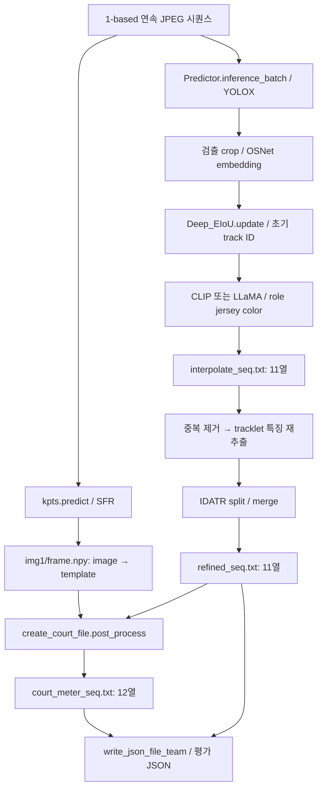

# Broadcast2Pitch 함수 감사·독립 Windows 파이프라인

작성일: 2026-11-13 (Asia/Seoul). 분석 기준: 공식 `main` 커밋 **`dbfb65c05c847e8e50baa47aa91ace960cc5e600`**, 커밋 시각 2026-06-02 11:26:05 +09:00. 임시 원본 clone은 `/private/tmp/mtah-broadcast2pitch-audit-20261113`이며 분석 시작 시 수정 사항이 없었다. MTAH 기준 HEAD는 `bd3b4c6551a34246ea3802dca4e1990530bd9d7f`다.

참고 문서 `/Users/kkj_1120/Downloads/GSR1_Broadcast2Pitch_Codex_Handoff.md`를 읽고 실제 커밋과 대조했다. 문서의 내용은 검토 대상이며, 사실 판정은 아래 소스와 관측 결과에 따른다. 처음 요청의 보존·분석 범위를 유지하면서, 후속 요청인 “Windows 환경에서 돌릴 수 있는 코드”에 따라 새 `broadcast_gsr/` 실행기를 추가했다. 기존 실행 코드·모델·ATD·제출물은 수정하지 않았다.

## 1. 판단과 검증 범위

검토할 가치가 있는 모듈형 트래킹 구현이지만, 현재 공개 코드를 MTAH 전체 경기에 그대로 실행해 ATD보다 정확하다고 판단할 근거는 없다. 시간축, 보정 행렬, ID, 관측 범위의 계약을 먼저 고정해야 한다. 특히 원본에는 confidence 재스케일, 빈 검출 프레임 건너뛰기, 실패 H의 identity 대체, 30초 데이터셋 가정이 있다.

핸드오프에서 바로잡을 두 가지가 있다.

- **H 저장·읽기 경로 불일치는 현재 커밋에서 확인되지 않는다.** `kpts.py`의 기본 인수 이름과 주석보다 실제 `np.save` 경로가 우선이다. 쓰기·읽기 모두 `img1/*.npy`다.
- **현재 활성 추적 경로를 일반적인 Kalman 예측 추적이라고 설명하면 부정확하다.** 클래스에 필터가 있고 초기화·재활성화에는 사용되지만, `Deep_EIoU.update()`는 `multi_predict()`를 호출하지 않는다. 일반 `STrack.update()`도 필터 상태를 갱신하지 않고 마지막 bbox와 특징을 갱신한다. 매칭은 `last_tlbr`를 사용한다. [추적 소스][tracker] [매칭 소스][matching]

| 증거 종류 | 이번에 수행한 것 | 뜻하지 않는 것 |
|---|---|---|
| 정적 분석 | 원본 주요 함수·호출·설정·I/O 분석, Python 194파일 AST 파싱 성공 | import·의존성 설치·모델 실행 성공 |
| 격리 함수 실행 | confidence, Tracklet 인수, ID split, LM 실패, Kalman 갱신 검증 | 전체 GSR 실행 |
| 합성 기하 | 4점 대응, H 정방향·역방향, 중심 이동·MTAH 치수 변환 | 실제 영상의 calibration 정확도 |
| 로컬 입력 확인 | MP4 메타데이터, ATD 프레임 연속성, H 행 수·valid 집계 | 전체 MP4 디코딩 및 영상↔ATD 동기 검증 |
| 새 실행기 테스트 | 고정된 core 의존성으로 테스트 15개 통과, 원본 Deep-EIoU와 합성 영상 연결 포함 | 공식 가중치·Windows·CUDA 실제 실행 성공 |

필수 체크포인트 추론, 전체 경기 추론, 학습, 점유 결과 생성은 수행하지 않았다. 새 코드도 미검증 경로는 명시적으로 구분한다. 상세 관측값은 [evidence.json](evidence.json), 원본 격리 검증 코드는 [audit_probes.py](audit_probes.py)에 있다.

## 2. 논문·챌린지 보고·공개 코드 구분

문헌은 [WACV 2026 논문][paper]과 [2025 챌린지 종합 보고의 GSR-1, §7.4][challenge]를 따로 읽었다. 원본 README가 링크하는 arXiv는 독립 Broadcast2Pitch 논문이 아니라 2025 챌린지 종합 보고다. README 자체도 SFR이 WACV 접근을 따르며 arXiv와 다르다고 설명한다. [README][readme]

| 비교점 | 문헌의 설명 | 현재 GitHub의 실행 경로 |
|---|---|---|
| 카메라 보정 | 챌린지 보고: multi-frame keypoint. WACV: keypoint·line·circle 최적화 | `kpts.py`의 단일 프레임 입력, `num_frames=1`, 실제 `frame_skip=1`. “29프레임 skip” 주석은 활성 값과 다름 |
| 기하 채널 | WACV: 97 keypoints, 18 lines | `Unet(out_ch=98, num_lines=21)`: keypoint 배경 포함 98, 21채널에는 18 기본 기하 항목 외 좌/우 circle·all-lines 포함 |
| 선수 속성 | LLaMA-3.2-Vision 중심, CLIP 비교 | YAML 기본 `CLIP`. `JERSEY_MODE`로 두 경로 선택 |
| IDATR split | role·jersey·color 다수결 | 함수는 `roles,jns,teams`를 비교. color 배열은 직접 쓰지 않음. 시간 gap이 없으면 속성 변화만으로 split하지 않음 |
| 병합 공간 제약 | 위치 연속성, 공간 임계값 | 이미지 bbox 중심의 x/y 차이를 전체 화면 관측 범위×factor와 비교. 기본 factor=1 |
| 팀 구분 | 유니폼 색과 평균 x로 left/right | 문자열 색 빈도→팀 0/1, 이후 평균 x·GK 위치·색 보정. H/A는 아님 |

WACV의 SoccerNet-GSR test 수치는 LLaMA 구성 GS-HOTA 61.48, CLIP 구성 60.13이며, 실험 장비는 RTX 4090 24GB다. **저자의 해당 데이터셋 실험값이지, 이번 코드 커밋의 재현값이나 MTAH 성능·최소 VRAM 요구량이 아니다.** [논문 Table 2/5, §4.3][paper]

## 3. 원본 함수별 계산·입출력·연결



여기서 모듈 이름 `interpolate_*`는 실제 보간 기능의 증거가 아니다. 메인 추론은 관측 track 행을 CSV로 저장하며 화면 밖 선수를 복원하지 않는다. SFR은 추적에 앞서 별도 실행되는 병렬 분기이며, 활성 메인 추론은 SFR 모델이나 H를 읽지 않는다.

### 3.1 YOLOX

| 함수 | 입력 → 계산 → 출력 | 다음 연결 |
|---|---|---|
| `exp.Exp.__init__()` | depth=1.33, width=1.25, class=1, `(800,1440)` 추론 크기 | `get_exp()`→`Exp.get_model()` |
| `Exp.get_model()` | `YOLOPAFPN`과 `YOLOXHead` 구성 | `_init_models()`가 `ckpt['model']` 로드 |
| `preproc()` | OpenCV BGR H×W×3 → 종횡비 유지 resize, 우/하단 114 pad, RGB/255, ImageNet normalize, CHW float32와 scale | `Predictor.inference_batch()`가 batch stack |
| `YOLOXHead.forward()/decode_outputs()` | 다중 scale feature→box·objectness·단일 class, grid/stride로 center와 exp(width,height) decode | `postprocess()` |
| `postprocess()` | center bbox→xyxy, objectness×class confidence threshold, 클래스별 NMS | 프레임별 `N×7`: xyxy,obj,class_conf,class_id |
| `process_video()` | CPU NumPy 변환, 원영상 bbox 복원, crop | OSNet과 tracker |

검출 크기는 H=800/W=1440이다. YOLOX의 단일 class 번호는 로스터 선수 ID가 아니다. 역할은 후단 속성 모델이 분류한다. reliable ball detector가 별도로 있는 구조도 아니다. [메인][inference] [YOLOX head][head] [검출 후처리][boxes] [전처리][preproc]

**확인된 결함:** `process_video()` 509~510행은 `det /= scale`로 7열 전체를 나눈다. 실제 1920×1080 입력의 scale=0.7407407에서 원 score=0.9×0.9=0.81이 **1.476225**가 된다. 좌표만 역스케일해야 한다. threshold와 ID 생성 조건에 영향을 줄 수 있지만, 정확도 영향의 크기는 측정하지 않았다.

### 3.2 OSNet

메인은 `FeatureExtractor(model_name='osnet_x1_0')`를 생성한다. 각 검출 bbox를 RGB로 crop하고 256×128 resize·ImageNet normalize한 Tensor를 넘겨 N×512 특징을 얻는다. `F.normalize(...,dim=1)` 결과가 같은 검출 순서로 `Deep_EIoU.update(det,embs)`에 전달된다. IDATR의 `generate_tracklets()`도 RGB crop과 동일 크기로 특징을 다시 계산해 관측마다 저장한다. [메인][inference] [tracklet 생성][gen]

OSNet 본체와 `FeatureExtractor`는 이 저장소에 없다. README가 지정한 [torchreid 공식 FeatureExtractor][extractor]·[OSNet 구현][osnet]도 확인했다. `OSBlock.forward()`는 1×1 축소→1/2/3/4개의 경량 3×3 분기→공유 channel gate 합→1×1 투영→residual이다. `OSNet.forward()`는 convolution feature→global average pool→FC를 거쳐 eval에서 512벡터를 반환한다. Tensor 입력의 `FeatureExtractor.__call__()`은 이미 전처리된 Tensor를 그대로 사용하므로 이 호출에서 이중 normalize하지 않는다.

**실행 연결 문제:** 메인 import는 `from reid.torchreid.utils ...`지만, 원본에 `reid/`가 없고 IDATR은 `from torchreid.utils ...`다. README대로 torchreid만 설치한 환경과 이 이름은 일치하지 않는다. 실제 모델 weights의 적합성과 누락 여부도 별도로 검사해야 한다.

특징은 외형 유사도이며, 그 자체로 실명·등번호·팀 확률이 아니다. 새 Windows 실행기는 OSNet 단일 정의를 고정 버전에서 읽고 trunk weight의 누락을 검사한다. 현재 원본에 포함된 Market1501 checkpoint를 SportsMOT 학습 checkpoint 대신 쓰지 않는다.

### 3.3 Deep-EIoU

`Deep_EIoU.update(output_results,embedding)`의 N×5 입력은 xyxy+score, N×7 입력은 xyxy+objectness+class_conf+class_id다. N×7이면 두 confidence의 곱을 사용한다. 활성 메인은 원래 N×7을 넘긴다.

| 순서·함수 | 계산 | 상태/출력 |
|---|---|---|
| `update()` 전반 | low=.05 미만 제거, high=.6 초과와 저신뢰군 분리 | 검출과 특징을 같은 mask로 선택 |
| `matching.expand/eious/eiou_distance` | bbox를 확장해 IoU, 비용=1−IoU. 고신뢰 반복 scale .7/.8 | 영상 공간 비용 행렬 |
| `embedding_distance()` | `smooth_feat`와 `curr_feat` cosine 거리/2, appearance=.25와 proximity=.5로 gating | IoU 비용과 원소별 minimum |
| `linear_assignment()` | `lap.lapjv(... cost_limit=.8)` | 매칭·미매칭 track/detection index |
| 2차 연관 | 남은 tracked와 low-score 검출, expansion=.5, threshold=.5 | bbox/feature 갱신 또는 lost |
| 미확인 track 처리 | threshold=.7 연관, 나머지 제거 | 신규 track은 score≥.7에서 활성화 |
| `STrack.update_features()` | 특징 L2 normalize, EMA .9 old+.1 new 재정규화 | `curr_feat`, `smooth_feat` |
| buffer·중복 제거 | `int(25/30×60)=50` update 동안 lost 유지, track 중복 제거 | `tracked_stracks` 반환 |

`STrack.activate()`는 8차원 `(cx,cy,w,h,vx,vy,vw,vh)` 필터 상태를 초기화하고 `re_activate()`는 필터 update를 한다. 그러나 현재 일반 연관 경로에는 predict가 없고, 일반 update에서 Kalman mean은 바뀌지 않는다. 격리 실행에서 bbox x가 10→110으로 바뀌어도 filter 기반 `tlwh.x`는 10, `last_tlwh.x`는 110이었다. **정의되어 있다는 사실과 호출된다는 사실을 분리해야 한다.** [추적][tracker] [매칭][matching]

또한 검출이 없으면 메인 `process_video()`가 tracker 호출 전에 `continue`한다. 이때 실제 영상 프레임은 진행하지만 tracker의 내부 counter와 lost buffer는 진행하지 않는다. 반환 track 순서는 검출 순서와 동일하다고 보장되지 않는데 `embs_for_frame[i]=embs[i]`로 팀 외형 보정에 사용한다. 잘못된 선수 특징이 연결될 가능성이 있다. 이번에는 원본 전체 추론에서의 발생 빈도를 측정하지 않았다.

### 3.4 Homography / SFR

활성 진입점은 `kpts.py:predict()`이며 `sfr/inference.py`를 직접 메인 추론에 연결하는 구조가 아니다. `SoccernetDataset`이 JPEG 목록을 만들고, `predict_soccernet_inference()`는 프레임을 다시 OpenCV로 읽어 처리한다. 실제 모델 입력 경로는 BGR tensor이므로 학습 색 순서와의 일치 여부는 가중치/학습 코드를 추가 확인해야 한다.

| 함수 | 입력·계산 | 출력·다음 연결 |
|---|---|---|
| `Unet.forward()` | EfficientNetV2-S encoder, nonlocal block, attention decoder | 98 keypoint heatmap, 21 line heatmap |
| `get_final_preds_torch()` | 최대 응답 좌표, Gaussian/log heatmap, Taylor 보정 | keypoint 좌표·confidence |
| `extract_line_points_from_heatmap()` | all-lines 혼합, 정규화·threshold, 연결 성분·thinning, fitLine·sampling | x,y,intensity 표본 |
| `extract_circle_points_from_heatmap()` | 고응답 표본, ellipse fit·기하 outlier 제거 | circle 표본 |
| `predict_soccernet_inference()` 중반 | 좌/우 line veto, keypoint-line 연결, 교점·선 투영 보정, missing-line keypoint 제거 | 원영상 픽셀 표본 |
| `normalization_transform_pts()` | 평균거리 √2가 되도록 좌표 정규화 | `T_i`, `T_p` |
| `estimate_inv_homography_line_circle_points_middle_pair()` | 대응점 DLT/RANSAC 초기화 또는 identity→LM 8변수 최적화 | 정규화된 image→template 행렬; 변수 이름만으로 방향 추정 금지 |
| `get_inv_residual...()` | line≥5면 line 대수 잔차, center circle 잔차. line<5이고 point≥4면 keypoint 재투영 잔차 | scalar residual 배열 |
| 마지막 저장 | 행렬 역변환·정규화 해제, 실패 시 point RANSAC, 또 실패하면 identity | `img1/<frame>.npy` |

line confidence 인수 `w`는 loop에서 읽지만 잔차에 곱하지 않는다. circle intensity도 잔차에 반영하지 않는다. keypoint 항은 `conf×거리`이며 4개 대응점이면 잔차 4개로 8변수 LM을 호출한다. 빈 keypoint 대응에서는 `np.stack([])`가 예외다. 두 오류를 격리 실행으로 재현했으며, 바깥 try가 이를 잡아 RANSAC fallback으로 갈 수 있으므로 매번 프로세스 전체가 종료된다는 뜻은 아니다. [SFR 전체][kpts]

### 3.5 CLIP / LLaMA, 팀 결정

`CLIPFinetune.forward()`는 ViT-L/14 image embedding에서 role 5개, digit1 11개, digit2 11개, color embedding 768차원을 출력한다. `predict_role_and_jersey_batch_clip()`는 실제로 crop별 순차 실행하며 role/digit argmax와 13개 색상 text embedding의 cosine argmax를 반환한다. 미관측 digit=10, jersey unknown=100 관례를 쓴다. `get_number()`는 일부 digit-null 조합을 잘못된 유효 번호로 만들 여지도 있어 새 실행기는 두 번째 digit 미관측이면 번호를 보류한다. [CLIP heads][cliphead] [인식 호출][inference]

LLaMA 분기는 Unsloth `FastVisionModel.from_pretrained(load_in_4bit=True)`로 로드한다. `predict_role_and_jersey_batch()`는 PIL crop과 지시문을 processor에 넣어 각 crop별 `generate(max_new_tokens=128)`하고, decode 결과의 마지막 줄을 comma로 분리한다. `.to('cuda')`가 고정이고 structured schema 검증이나 calibration된 확률은 없다. 파싱 실패는 `(Player,100,Unknown)`으로 바뀐다. 이름에 batch가 있어도 generation 자체는 crop별이다.

메인은 프레임 내 다빈도 두 색상으로 team=0/1, 나머지는 -1을 먼저 정하고 외형 centroid로 일부 보정한다. 이후 `global_color_team_assignment()`가 영상 전체 색 빈도로 player 팀을 다시 쓰고, `unify_team_assignments()`가 track별 다수결한다. 따라서 앞의 외형 보정이 최종 결과에 그대로 남는다고 볼 수 없다. GK·referee는 player 규칙과 다르다. 색상이나 좌우 라벨을 H/A로 자동 확정하지 않아야 한다.

### 3.6 IDATR 및 최종 포맷

| 함수 | 입력·계산 | 출력·연결 |
|---|---|---|
| `remove_double_bbox()/check_double_bboxes()` | 11열 TXT, 매 프레임 IoU>.15·y-center차<3·동일 색 검출 중복 | `rmved_<seq>.txt`. **1..750 고정** |
| `generate_tracklets()` | rmved TXT, `imgs[frame_id-1]`, bbox crop, OSNet 재계산·L2 normalize | 관측 frame/bbox/score/role/jersey/color/team/features를 가진 Tracklet pickle |
| `detect_id_switch()/split_tracklets()` | frame gap>25의 양쪽 속성 다수결 불일치 | 새 tracklets. 연속 구간 내 속성 전환은 놓칠 수 있음 |
| `get_distance()/get_distance_matrix()` | 시간 교집합 또는 role/team/선택 jersey 불일치면 비용=1. 나머지 모든 관측쌍 cosine 거리 평균 | K×K 비용; 단순 정규화 centroid 거리와 다름 |
| `get_spatial_constraints()/check_spatial_constraints()` | 전체 이미지 bbox 중심의 x/y 범위×factor, subtrack 끝/시작 차이 비교 | meter·speed 제약 아님. 기본 factor=1은 원 관측 범위 전체를 허용 |
| `merge_tracklets()` | 비용<.4 최소 쌍을 반복 병합·행렬 재계산 | 속성/관측 list 연결. 병합 후 시간 정렬 보장 없음 |
| `save_results()` | track ID를 다시 1..K 부여, frame별 정렬 | `refined_<seq>.txt` 11열. **score를 1로 대체** |
| `create_court_file.post_process()` | refined bbox 하단 left/right/middle에 해당 프레임 H 적용, template 중심 빼기 | `court_meter_<seq>.txt` 12열 |
| JSON `majority_voting()` | 역할·색상·등번호 집계, unknown=100 특별 처리 | track별 속성 |
| `determine_team_sides()` | team별 평균 x, GK의 x부호 | left/right 라벨 |
| `write_predictions_json()` | frame/track 결합, 면적<800을 ball로 변경, 색-팀 보정, other/일부 짧은 track/영역 밖 필터 | SoccerNet 평가 JSON |

`Tracklet.extract()`는 5번째 위치 인수에 features를 넣지만 생성자의 5번째 인수는 role이다. 격리 실행에서 features·jersey가 사라지고 role에 ndarray가 들어갔다. 현재 주된 호출처는 공간 검사 임시 subtrack이므로 이 결함만으로 전체 IDATR이 반드시 중단된다고 할 수는 없다. [Tracklet][tracklet] [중복 제거][rmv] [생성][gen] [IDATR][refine] [투영][court] [JSON][json]

JSON 결합도 주의해야 한다. `(frame,track_id)` 좌표 행이 없으면 같은 track의 첫 행을 대신 사용하므로 다른 시각 좌표가 붙을 수 있다. bbox 면적으로 ball을 강제하는 규칙은 소형 원거리 선수를 오인할 수 있으며, 독립적인 ball tracker가 아니다. JSON은 확률이나 신뢰도를 보전하는 일반 interchange 형식으로 바로 쓰기 어렵다.

## 4. 경로·프레임·좌표 계약

### 실제 H 경로

```text
kpts.predict(img_path=.../SNGS-xxx/img1)
  predict_soccernet_inference:
    npy_directory = os.path.dirname(key_frame_path)        # line 1187
    np.save(npy_directory / frame_stem.npy, H)             # line 1522

create_court_file.post_process:
    glob(DATA_DIR/split/seq/img1/*.npy)                    # lines 75..77
```

따라서 현재 커밋의 기본 경로는 일치한다. `result_dir`, `npy_subfolder="npy_files"` 인수가 존재하지만 실제 H 저장 위치를 결정하지 않는다. 입력 폴더 안에 결과를 쓰는 설계이므로 기존 MTAH 데이터에 원본을 직접 연결하지 않는 것이 좋다. 원본 저장소 예시 JPEG는 `SNGS-196/000001.jpg`에 있고 메인에서 찾는 `img1/` 하위가 아니므로 기본 실행이 해당 예제를 건너뛸 수 있다.

그러나 **프레임 결합 문제는 실제 존재**한다. 투영은 정렬된 `.npy` 리스트의 `[frame_num-1]`를 사용한다. 중간 H 파일 한 개가 없으면 뒤의 H가 다른 프레임으로 이동한다. `gen_tracklets()`도 JPEG 목록에서 같은 방식으로 읽는다. frame_id를 키로 결합해야 하며 누락을 index shift로 보정하면 안 된다.

### H 방향과 치수

실제 `kpts.py` 최종 H는 `image pixel → template coordinate`다. `create_court_file`가 그 H를 bbox 하단 픽셀에 직접 곱한다. template PNG는 실제 **125×78**, 필드 모서리는 `(10,5)..(115,73)`, 중심 `(62.5,39)`다. `pixel_to_meter_all()`은 이 중심을 빼기만 한다. 일반 이미지 픽셀을 미터로 환산하는 함수가 아니라, template가 이미 단위 축척으로 정의된다는 전제다.

```text
video point p = [u, v, 1]
template q = dehomogenize(H_gsr @ p)
original court_meter = (q.x - 62.5, q.y - 39)

MTAH normalized = ((q.x - 10)/105, (q.y - 5)/68)
MTAH metres     = (x_norm*105.3, y_norm*68.0)
```

하프별 축 반전은 위 산술식에 포함하지 않는다. 실제 영상·팀 메타데이터로 방향을 따로 확인한다. 공통 모델 치수를 실제 필드 길이에 선형 rescale하는 정책이며, 105m template와 실제 105.3m의 차이를 보존한다.

반대로 기존 MTAH `starter/load_homography.py`는 **normalized pitch→image** 행렬을 읽는다. 선수 픽셀을 pitch로 보내려면 `H_mtah^-1`가 필요하다. 새 실행기는 모든 입력 H를 이 계약으로 통일하며, learned H는 `inverse(T_template_to_norm @ H_gsr)`로 바꿔 저장한다.

합성 4점 왕복 오차는 image→template <6×10^-14 template unit, 역방향 <6×10^-13 pixel이었다. 이는 변환식·구현 검사이며 실제 H 정확도·축 방향을 입증하는 값이 아니다. 실패 H는 identity 대신 invalid와 빈 좌표로 전파한다.

### 로컬 데이터 확인

| 소스 | MP4 메타데이터 | ATD | H | H valid |
|---|---:|---:|---:|---:|
| broadcast | 164,487 frames, 25fps, 1920×1080 | 164,488, 1-based 연속 | 164,488, 0-based 연속 | 108,248 |
| tactical | 199,319 frames, 25fps, 1920×1080 | 199,319, 1-based 연속 | 199,319, 0-based 연속 | 199,319 |

MP4 실제 파일명은 두 소스 모두 `*-001.mp4`이며 기존 `games.asset_paths()`의 `*.mp4` 이름과 다르다. 새 설정에 실제 이름을 명시했고 원본 파일을 rename하지 않았다. broadcast 1프레임 차이의 원인은 미확인이다. 프레임 총수 차이만으로 첫 프레임 offset을 결정하거나 마지막 ATD를 삭제하면 안 된다. 전체 sequential decode·PTS와 여러 영상 anchor를 검증할 계획이다.

기존 `final_tracking_alignment_report.json`을 만드는 코드는 `full_half_synchronization_verified=false`, `broadcast_mp4_alignment_verified=false`로 기록한다. `SYNC_CANDIDATES.md`도 같은 미검증 경계를 설명한다. 기존 정렬표를 새 영상 추론의 확정 시간축으로 사용하지 않는다.

## 5. 위험 항목 감사표

`confirmed`는 소스에서 확인 또는 소규모 재현했다는 뜻이며 성능 저하량을 측정했다는 뜻은 아니다. `likely`는 실패 조건의 가능성이 있고 전체 실행 재현은 없다는 뜻이다. `not_reproduced`는 이번 기준 커밋에서 해당 주장을 지지하지 못했다는 뜻이다.

| 핸드오프 항목 | 판정 | 확인 내용·처리 |
|---|---|---|
| 1 H 저장/읽기 경로 불일치 | **not_reproduced** | 현재 쓰기·읽기 모두 img1. 실제 문제는 입력 폴더 쓰기와 리스트 인덱스 결합 |
| 2 고정 750프레임 | confirmed | 중복 제거 단계에서 확인; 새 실행기는 이 단계를 그대로 호출하지 않음 |
| 3 개인 Python 경로 | confirmed | shell에 `/home/ymo/.../python`; 별도 Windows cmd·venv 작성 |
| 4 test split 고정 | confirmed | 메인·JSON이 YAML 대신 test 사용; 새 실행기는 MP4 명시 |
| 5 1-based 연속 파일 가정 | confirmed | JPEG/H 리스트의 frame-1. 새 실행기는 원영상 frame 키와 map 명시 |
| 6 identity H 저장 | confirmed | 실패 시 identity; 새 실행기는 invalid로 처리 |
| 7 팀 라벨 규칙 | confirmed, 정확도 미검증 | 색/평균 x 기반. 새 실행기는 H/A 명시 map만 허용 |
| 8 ReID index | likely | 반환 track index와 detection index 혼용. 새 어댑터 순서 반전 합성 검사 통과 |
| 9 empty-frame 미갱신 | confirmed | 메인 continue. 새 실행기는 매 decoded frame tracker.update 호출 |
| 10 18 vs 21 line | confirmed | 채널 정의 차이. 가중치 없이 임의 채널 변경 금지; 원 architecture 유지 |
| 11 입력 크기 상수 | confirmed | 800×1440 상수, score까지 역스케일. 새 실행기는 좌표만 변환 |
| 12 점유/ball 기능 | confirmed: 부재 | H/A/D·볼 소유자 독립 추론 없음. 면적 ball 규칙을 ball tracker로 해석 금지 |
| 13 라이선스/weights | 일부 확인, 나머지 미확인 | 루트 포괄 LICENSE 없음. `sn-trackeval/LICENSE` MIT만 확인. 체크포인트 권리·전체 외부 코드 권리는 별도 확인 대상 |

추가 발견: `reid.torchreid` import 불일치; `Tracklet.extract()` 인수 오류; 원본 SFR 빈 stack/LM 제약식 부족; `FP16=True`일 때 input만 half로 만들고 detector를 half로 바꾸지 않는 경로; 작은 bbox를 분류에서 제외해도 미리 만든 `detection_info`에서 출력되는 경로; 병합한 시간 list를 정렬하지 않는 경로; 최종 score=1 대체; JSON의 다른 프레임 좌표 fallback. 이 가운데 source 확인과 실제 전체 영상 실패 재현을 혼동하지 않는다.

## 6. 독립 Windows 구조와 변환 계약

실행 방법은 [Windows README](../../broadcast_gsr/README.md)에 있다. 원본 clone을 수정하지 않고 새 adapter가 필요한 모델 정의·추적기를 읽는다. 사용자 기존 환경 대신 `broadcast_gsr/.venv`를 사용하고, 출력은 새 `data/derived/broadcast_gsr/<run>`에만 만든다. 기존 폴더 재사용을 거부한다.

| 새 파일/영역 | 역할 | 검증 상태 |
|---|---|---|
| `setup_windows.cmd`, `run_windows.cmd` | Windows x64 Python 3.11, CPU/CUDA profile, 독립 환경 | 작성, Windows 실행 미검증 |
| `upstream.py`, `matching.py` | 고정 소스·원본 Deep-EIoU, Cython/LAP 대신 NumPy/SciPy | 실제 원본 추적기 합성 검사 통과; LAP tie는 달라질 수 있음 |
| `models.py` | YOLOX·OSNet·선택 CLIP, checkpoint 구조 검증 | 실제 가중치 로딩·추론 미검증 |
| `geometry.py`, `calibration.py` | normalized→image H 계약, 선택 SFR, empty/LM 보정 | 기하·LM 합성 검사 통과; SFR 신경망 미실행 |
| `pipeline.py` | MP4 stream, 매 프레임 update, 명시적 검출 join, 관측/품질/overlay | 합성 영상 연결 검사 통과 |
| `refinement.py` | IDATR-inspired 분할·병합, meter/time 제약, 원 관측·score 보존 | 합성 보존 검사 통과, ID 정확도 미검증 |
| `compare.py` | ATD 익명 위치 집합 불일치·미매칭 진단 | 합성 검사 통과, 실경기 비교 미수행 |

핵심 계약은 다음과 같다.

| 데이터 | 원본/MTAH의 의미 | 새 실행기 계약 |
|---|---|---|
| frame | 원본 JPEG=1-based, MTAH ATD=1-based, 영상/H=0-based | 원영상 `frame_idx` 0-based, timestamp=frame/fps. source별 독립 |
| bbox | xyxy 검출, tlwh track | 원영상 픽셀의 tlwh와 하단 중앙 `image_x/y` 명시 |
| pitch | 원본 center metre, MTAH normalized | `pitch_x/y_norm`, 코너 원점 `pitch_x/y_m` 병기 |
| identity | 원본 clip별 재부여 ID, ATD 46 슬롯은 고정 개인 신원 아님 | `camera_segment_id`+local track ID. roster identity와 구별 |
| team | 0/1/-1 또는 left/right | `team_raw=color:...`, `team_ha`는 명시 검증 map 없으면 빈값 |
| confidence | 원본 final score가 1로 바뀜 | 검출 score 보존. role score와 color cosine 분리, id/team 확률 빈값 |
| missing | 원본 H identity fallback, track 무행 | H invalid→빈 pitch. `frames.csv`는 빈 검출 프레임도 보존 |
| label | 기존 제출 H/A/D/X | 이 트래킹 결과에는 점유 label을 생성하지 않음 |

현재 native Windows 경로에 LLaMA/Unsloth를 넣지 않았다. CLIP은 선택할 수 있고 최초 기본은 속성 미추정이다. IDATR 원본 완전 재현·컷 간 global identity도 완료로 표시하지 않는다. 제공된 H를 쓴 A 실행과 learned H를 쓴 B 실행을 분리하여 검출/추적 개선과 calibration 개선을 구별한다.

## 7. 작은 샘플에서 성능 확인까지

1. **Windows preflight**: Python/Git/PyTorch/torchvision import, CPU/CUDA, 체크포인트 해시·architecture, 실제 MP4 이름을 확인한다. `doctor`와 `smoke`를 실행한다. smoke 성공을 모델 성공으로 해석하지 않는다.
2. **100프레임 모델 실행**: 사람이 연속 라이브·카메라 구간을 확인한 샘플을 지정한다. YOLOX/OSNet만 먼저 실행하고, crop와 bbox를 확인한다. 이후 CLIP을 켜서 속성 분기를 분리 점검한다.
3. **750프레임 pilot**: 선수 교차·가림·원거리·팬/줌·GK·세트피스를 포함한 여러 구간을 사용한다. 프레임별 관측 수·누락·좌표 점프·ID 전환·H invalid·카메라 컷을 집계한다. 장면 유형은 별도 검증한다.
4. **보정 독립화**: 같은 구간에 제공 H와 learned SFR H를 각각 적용한다. 수동 필드 라인/키포인트 holdout의 reprojection error, valid coverage, 원거리/화면 끝 오차를 분리한다.
5. **후처리 ablation**: online만, CLIP 포함, IDATR-inspired 포함을 같은 샘플·고정 detection·동일 H로 비교한다. 분할·병합으로 사라진 관측이나 잘못 합친 ID를 평가한다. 원본 IDATR의 재현을 원한다면 추가로 원본 결함 보정 patchset과 baseline을 별도 실험한다.
6. **시간축 확인**: broadcast MP4↔broadcast ATD를 먼저 확인하고, 그 뒤 컷/리플레이를 처리한 piecewise broadcast↔tactical map을 만든다. 서로 다른 두 카메라의 전체 길이 차이를 단일 offset으로 해결하지 않는다.
7. **확장 판단**: 실제 Windows pilot의 peak CPU RAM/GPU VRAM, 초당 프레임, disk 증가, H 성공률을 측정해 전체 경기 chunk·재시작·컷간 ID 설계를 결정한다. 먼저 전체 경기 GPU 작업이나 대규모 학습을 돌리지 않는다.

자원 계획은 아직 추정이다. 기본 online 실행은 stream 방식이고 IDATR-inspired pilot만 한 번에 최대 3,000프레임으로 제한한다. 750프레임×평균 관측 20명×512×4byte의 특징만 약 **30.7MB**이며, 이는 산술 예시이지 실제 관측 선수 수나 전체 메모리 측정치가 아니다. YOLOX/CLIP activation·모델·영상·Python 객체는 별도다. LLaMA는 이 Windows 경로에 포함하지 않는다. 실제 GPU의 최소 VRAM이나 처리량은 측정 전 확정하지 않는다.

## 8. ATD 비교 검증 설계

**ATD와의 거리 차이는 정확도와 다르다.** 같은 오류가 있는 H를 공유하면 거리 차이가 작아질 수 있고, ATD가 틀린 구간에서는 새 추정이 좋아도 ATD와 더 멀어질 수 있다. 최종 판단에는 두 방법에서 독립적으로 확인한 표본이 필요하다.

| 평가 단위 | 방법 | 보고할 값·함정 |
|---|---|---|
| 같은 broadcast 프레임 위치 집합 | 동기·축 검증 후 일대일 Hungarian 대응, team을 확인한 경우만 team 제약 | median/P95 불일치와 양쪽 미매칭 수. gate로 큰 오류가 제외된 수 같이 표시 |
| 이미지 위치 | 사람이 확인한 발의 지면 접점/가림 상태와 bbox 하단 비교 | 픽셀 오차, 작은 선수·가림별 분해. bbox bottom은 pose foot GT가 아님 |
| 실제 pitch 위치 | 별도 검증한 camera geometry와 수동 표본, 가능하면 동기 tactical 관측 | 위치 오차(m), median/P95, 0.5/1/2/5m 이내 비율. 기준 geometry의 오차도 보고 |
| 시간 identity | 짧은 연속 구간에 수동 동일 선수 ID 부여 | ID switches, fragmentations, IDF1/HOTA. ATD 슬롯을 개인 GT로 사용하지 않음 |
| 의미 identity | 실제 확인 가능한 번호·팀·역할 표본만 별도 채점 | 정확도와 unknown/abstention 비율. 모르는 번호를 강제로 맞추지 않음 |
| 궤적 물리성 | 동일 관측 ID·동일 장면 내 실제 dt로 속도/가속 계산 | jump 비율, ID 전환·H 흔들림·시간 오차를 분리. 저속·매끈함만으로 우수 판정 금지 |
| 관측 범위 | 화면에 보이는 선수만 기준으로 표시 | visible recall와 false positive, H valid, 미매칭/결측. 화면 밖 22명 전체 복원으로 해석 금지 |

표본을 normal/가림/컷/리플레이/클로즈업/라인 부족/세트피스/하프별로 층화하고, 개발용 구간과 평가용 구간을 시간적으로 분리한다. 같은 경기의 인접 프레임을 독립 표본처럼 bootstrap하지 않고 clip 단위 신뢰구간을 사용한다. 사람이 확인한 영상/좌표 표본은 로컬 평가용으로 관리하며 기존 제출 데이터와 섞지 않는다.

채택 조건은 평가 전에 정한다. 예를 들어 동일 visible subset에서의 수동 기준 위치 오차·ID 오류 감소, coverage 손실 한도, calibration 무효 처리, Windows 실행 재현성 등을 함께 본다. 수치 기준은 프로젝트 목적에 맞춰 사전 고정해야 하며 이번에 근거 없는 합격 수치를 제시하지 않는다.

트래킹이 개선된 다음에만 기존 점유 모델의 입력을 별도 source로 연결한다. 공·시간 정렬·H/A map·점유 알고리즘·후처리 조건을 고정한 A/B 실험으로 macroF1과 spellF1을 비교한다. GSR은 독립 ball 추적이나 D 판정기를 제공하지 않으므로, 선수 좌표 개선과 ball/scene/점유 모델 변경의 효과를 섞지 않는다. 전체 경기 private GT를 이용한 튜닝·새 제출물 생성은 이번 작업에 포함하지 않았다.

## 9. 재현·보존 기록

원본 격리 감사는 두 로컬 interpreter에서 실행했다. SciPy 함수 검증은 Anaconda base, 기하·로컬 입력 메타데이터는 기존 mtah2027 interpreter를 읽기 전용으로 사용했다. 원본 요구환경을 설치한 것이 아니다. 필요한 PDF reader는 임시 폴더에만 설치했다.

새 실행기 테스트는 별도 `/private/tmp/mtah-broadcast-gsr-tests` 환경의 Python 3.11, numpy 1.26.4, scipy 1.14.1, opencv-contrib 4.10.0.84, Pillow 11.0.0, loguru 0.7.3에서 실행했다.

```bash
GSR_UPSTREAM=/private/tmp/mtah-broadcast2pitch-audit-20261113 \
PYTHONDONTWRITEBYTECODE=1 \
/private/tmp/mtah-broadcast-gsr-tests/bin/python -m unittest discover -s broadcast_gsr/tests -v
```

결과: **15 tests, OK, skip 0**. 실제 모델 weights는 필요하지 않은 테스트다. 원본 추적기의 실행, 합성 24프레임 decode/overlay, 빈 검출·invalid H·ID namespace·관측 보존을 검사했다.

추가한 경로는 `broadcast_gsr/`와 `docs/broadcast2pitch_audit_20261113/`뿐이다. 기존 Git tracked diff는 작업 전 snapshot과 비교해 변화가 없음을 확인한다. 기존 미추적 문서·모델·결과도 작업 대상으로 삼지 않았다. 원본 소스는 `/private/tmp`에 보존했고 패치하지 않았다. Windows에서 `bootstrap`을 실행하면 새 package의 ignored vendor 안에 고정 clone을 별도로 만든다. 대용량 경기 파일이나 새 좌표 결과는 외부 서비스에 업로드하지 않았다.

[readme]: https://github.com/yinmayoo185/SoccernetGSR/blob/dbfb65c05c847e8e50baa47aa91ace960cc5e600/README.md
[inference]: https://github.com/yinmayoo185/SoccernetGSR/blob/dbfb65c05c847e8e50baa47aa91ace960cc5e600/inference_soccernetGSR.py
[head]: https://github.com/yinmayoo185/SoccernetGSR/blob/dbfb65c05c847e8e50baa47aa91ace960cc5e600/yolox/models/yolo_head.py
[boxes]: https://github.com/yinmayoo185/SoccernetGSR/blob/dbfb65c05c847e8e50baa47aa91ace960cc5e600/yolox/utils/boxes.py
[preproc]: https://github.com/yinmayoo185/SoccernetGSR/blob/dbfb65c05c847e8e50baa47aa91ace960cc5e600/yolox/data/data_augment.py#L189
[tracker]: https://github.com/yinmayoo185/SoccernetGSR/blob/dbfb65c05c847e8e50baa47aa91ace960cc5e600/yolox/EIoU_tracker/Deep_EIoU.py
[matching]: https://github.com/yinmayoo185/SoccernetGSR/blob/dbfb65c05c847e8e50baa47aa91ace960cc5e600/yolox/EIoU_tracker/matching.py
[kpts]: https://github.com/yinmayoo185/SoccernetGSR/blob/dbfb65c05c847e8e50baa47aa91ace960cc5e600/kpts.py
[cliphead]: https://github.com/yinmayoo185/SoccernetGSR/blob/dbfb65c05c847e8e50baa47aa91ace960cc5e600/jersey_model/CLIPFinetune.py
[rmv]: https://github.com/yinmayoo185/SoccernetGSR/blob/dbfb65c05c847e8e50baa47aa91ace960cc5e600/IDATR/rmv_doub_bbox.py
[gen]: https://github.com/yinmayoo185/SoccernetGSR/blob/dbfb65c05c847e8e50baa47aa91ace960cc5e600/IDATR/gen_tracklets.py
[tracklet]: https://github.com/yinmayoo185/SoccernetGSR/blob/dbfb65c05c847e8e50baa47aa91ace960cc5e600/IDATR/Tracklet.py
[refine]: https://github.com/yinmayoo185/SoccernetGSR/blob/dbfb65c05c847e8e50baa47aa91ace960cc5e600/IDATR/refine_tracklets.py
[court]: https://github.com/yinmayoo185/SoccernetGSR/blob/dbfb65c05c847e8e50baa47aa91ace960cc5e600/IDATR/create_court_file.py
[json]: https://github.com/yinmayoo185/SoccernetGSR/blob/dbfb65c05c847e8e50baa47aa91ace960cc5e600/write_json_file_team.py
[extractor]: https://github.com/KaiyangZhou/deep-person-reid/blob/f8cd150fdf77e8d9e1ed143b7f308c2c609ded50/torchreid/utils/feature_extractor.py
[osnet]: https://github.com/KaiyangZhou/deep-person-reid/blob/f8cd150fdf77e8d9e1ed143b7f308c2c609ded50/torchreid/models/osnet.py
[paper]: https://openaccess.thecvf.com/content/WACV2026/papers/Oo_Broadcast2Pitch_Game_State_Reconstruction_from_Unconstrained_Soccer_Videos_WACV_2026_paper.pdf
[challenge]: https://arxiv.org/pdf/2508.19182
