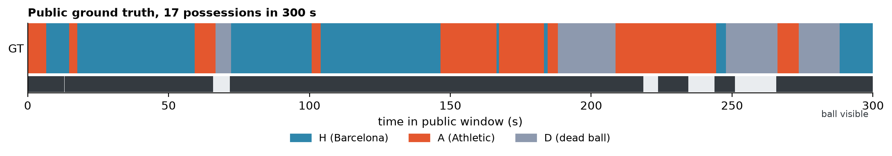
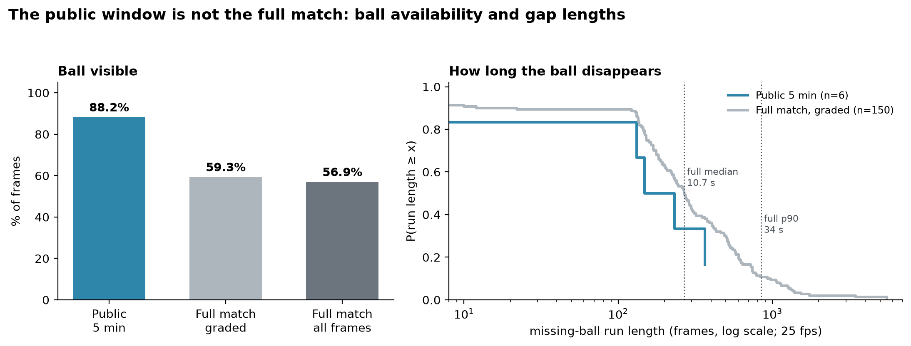
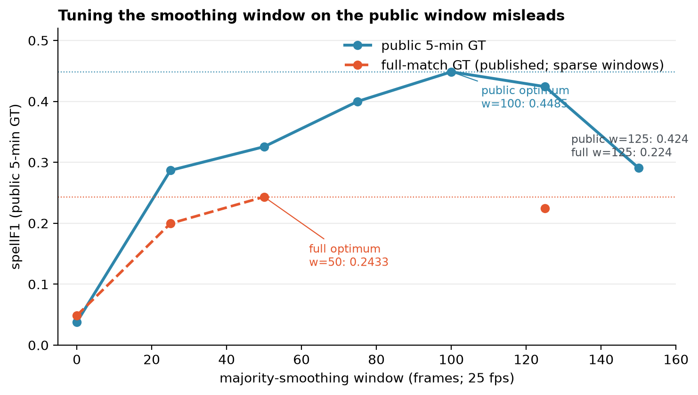
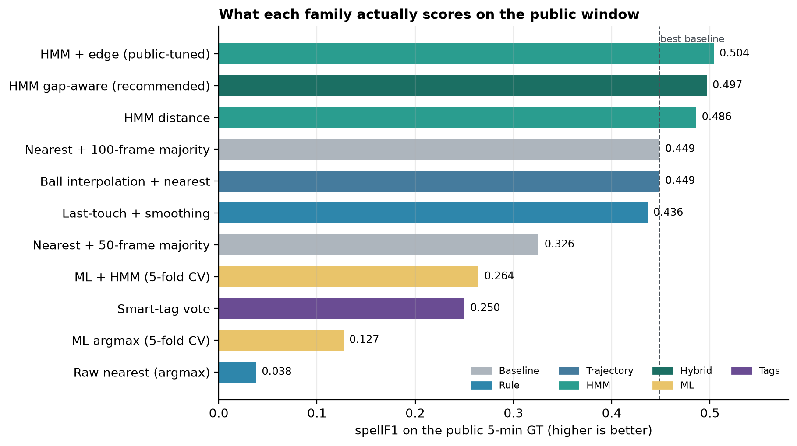
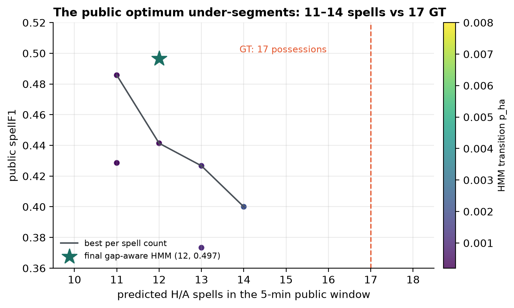
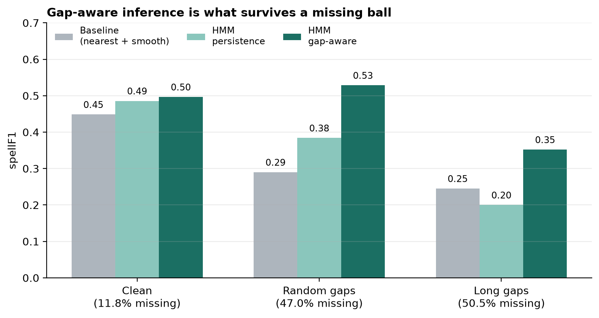
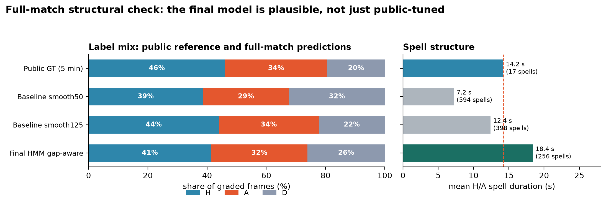
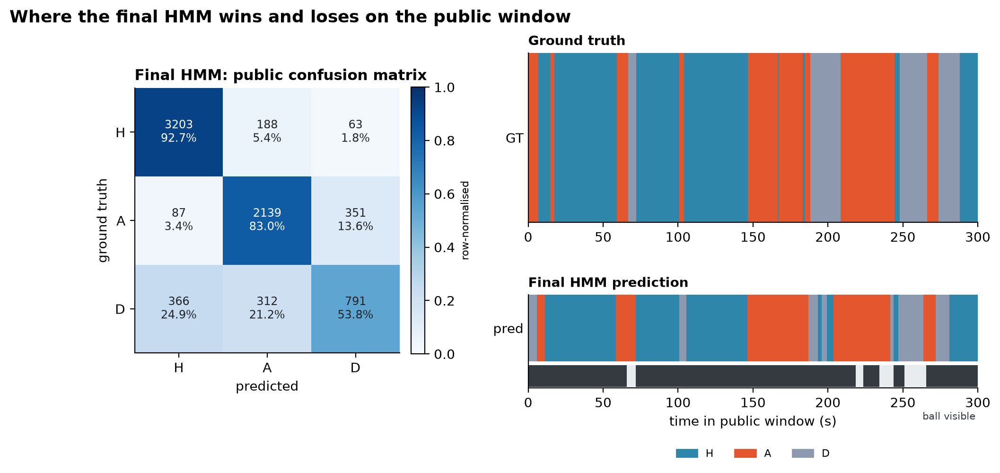

# More than a Hack 2027 — Phase 1: Ball Possession

## Solution research, empirical evaluation, and recommendation

**Match:** FC Barcelona vs Athletic Club, LaLiga EA Sports 2024–25, matchday 2  
**Data:** 199,319 tactical frames at 25 fps; 158,857 graded frames (≈106 minutes)  
**Primary metric:** `spellF1` (segment-level possession F1, averaged over IoU thresholds 0.3–0.7)  
**Tie-break:** `macroF1` over `H`, `A`, `D`  
**Report date:** 20 October 2026  
**Status:** research and recommendation only — the chosen solution has not been implemented; the models in §4 are research prototypes.

> **What this report is for.** It proposes and compares several ways to solve the possession task, reports what each one actually scores on the public ground truth and on stress tests, explains the published literature behind each family, and gives a recommendation. The recommendation is a starting point for a decision, not an implementation. The final choice is yours.

---

## TL;DR — recommendation

**Build a gap-aware hybrid HMM.**

It combines three things:

1. **Possession-zone evidence** from player–ball geometry (the nearest-player and possession-zone ideas of Link & Hoernig [1] and Vidal-Codina et al. [2]).
2. **A three-state sequence model** (`H`, `A`, `D`) with a strong self-transition prior and Viterbi decoding, so short tracking noise does not fragment possessions.
3. **Explicit handling of missing-ball gaps.** Short gaps use the sequence prior and last-team persistence. Long gaps use player proximity to the last known ball position, the smart-tag phase prior, and edge/out-of-play evidence.

On the public 5-minute ground truth it scores **0.4966 spellF1**, **0.7709 macroF1**, and **0.5916 D-F1**, versus **0.4485 / 0.5976 / 0.1992** for the best public smoothing baseline. Under synthetic missing-ball stress it degrades much more gracefully: **0.5286** with 47.0% of the scored window's ball observations missing and **0.3520** with long gaps and 50.5% missing, versus **0.2900 / 0.2452** for the baseline. Its full-match structure is also plausible: **256 H/A spells, mean 18.4 s, H 41.4% / A 32.5% / D 26.1%**, compared with **17 spells, mean 14.2 s, H 46.1% / A 34.4% / D 19.6%** in the public window.

The honest caveat is important: the public ground truth has only **17 possessions**, and the 95% bootstrap interval for the recommended model's spellF1 is **[0.303, 0.693]**. The interval overlaps the baselines. The public score alone is **not** statistically decisive. The recommendation rests on three pieces of evidence together: the public score, the missing-ball stress results, and the full-match structural check.

**High-ceiling alternative:** a PathCRF- or Ball Radar-style learned player-trajectory model. PathCRF reports **69.64% possession-edge accuracy** and **75.69% event F1** using player trajectories only, at 5 FPS [6]; Ball Radar reports **<3.7 m mean ball-position error** and **64.7% possession accuracy** [5]. These are the strongest published “ball-free” approaches, but they need large labeled tracking datasets, GPU training, and substantial engineering. They are the right bet only if the team has an ML engineer with spare capacity and a realistic path to external labeled data.

**Not recommended as the primary solution:** pure ML trained on the 5-minute public labels (cross-validation spellF1 0.1269 raw, 0.2643 after HMM smoothing), smart tags alone (0.2500), ball interpolation plus nearest-player (no gain over smoothing), or video-only detection (powerful literature, but a separate computer-vision project).

| Rank | Approach | Public spellF1 | Missing-ball robustness | Effort | Recommendation |
|---:|---|---:|---|---|---|
| **1** | **Gap-aware hybrid HMM** | **0.4966** | **Strong** (0.529 / 0.352) | Medium | **Recommended** |
| 2 | PathCRF / Ball Radar adaptation | not measured on this metric; PathCRF 0.7569 event F1, Ball Radar 0.647 possession acc. | Very strong in principle (player-only) | Very high | High-ceiling alternative |
| 3 | Rule-based possession zone + hysteresis | 0.4364 (last-touch variant) | Weak | Low | Fallback / feature layer |
| 4 | Learned TCN/CRF with external labels | not comparable; 5-min ML proxy 0.2643 | Medium | High | Only with more labels |
| 5 | Pitch control + HMM | not measured | Medium–strong | Medium–high | Optional feature |
| 6 | Smart-tag-only | 0.2500 | Weak | Very low | Prior only |
| 7 | Ball imputation + nearest | 0.4485 | Weak | Low–medium | Preprocessing only |
| 8 | Video-only detection | not measured | Medium | Very high | Separate project |

The ranking is expanded, with raw scores and weights, in [§5](#5-decision-matrix-and-ranking).

---

## 1. What the challenge actually rewards

The task is to label every frame of a full match with `H` (home possession, ball alive), `A` (away possession, ball alive), `D` (dead ball), or `X` (no answer). The tactical tracking has **199,319 frames**; **158,857** are graded, about **106 minutes** of play. The public ground truth covers only the first **5 minutes / 7,500 frames** [13].

The ranking metric is `spellF1`, not frame accuracy. A possession is a maximal run of `H` or `A`; dead-ball runs are stoppages, not possessions. Predicted possessions are matched one-to-one to true possessions by temporal IoU, and F1 is averaged over IoU thresholds 0.3, 0.4, 0.5, 0.6 and 0.7. `macroF1` is the unweighted mean of the per-class frame F1 scores and is used as the tie-break [13].

Three consequences shape every design decision:

- **Frame-level accuracy is not enough.** A model can be 80% frame-accurate and still produce a completely unrealistic number of possessions. The public baseline sweep is the clearest example: `baseline_smooth50` has public macroF1 0.6207 but spellF1 only 0.3256; `baseline_smooth125` has lower macroF1 0.5812 but higher spellF1 0.4242.
- **`X` has asymmetric value.** On `spellF1`, `X` is forward-filled from the last non-`X` label in the same half; inside a possession, abstaining is free. On `macroF1`, every `X` on a graded frame is a miss. So abstention is most useful inside an occlusion and most costly at a hand-over.
- **The effective sample is possessions, not frames.** The public window has 17 possessions. One missed possession moves public spellF1 by roughly six points. The organisers' own documentation warns that differences below about **0.04 spellF1** are noise on the full match, and the public window is even noisier [13].

Useful reference points from the metric implementation [13]:

| Case | spellF1 |
|---|---:|
| Perfect | 1.0000 |
| Perfect but 1 frame late | 1.0000 |
| Perfect but 3 frames late | 0.9818 |
| Perfect but 8 frames late | 0.8933 |
| Perfect but 1 second late | 0.6539 |
| Random / constant guess | 0.0000 |

This is why a sequence model with a duration prior is attractive: it can absorb one-frame jitter for free, but it still has to put the boundaries in roughly the right second.

---

## 2. Data: what makes this hard

### 2.1 The public window is small and unusually easy

The public ground truth contains **17 H/A possessions** and **4 dead-ball spells** in 5 minutes:

| Statistic | Public GT |
|---|---:|
| Frames | 7,500 |
| `H` frames | 3,454 (46.1%) |
| `A` frames | 2,577 (34.4%) |
| `D` frames | 1,469 (19.6%) |
| H/A possessions | 17 |
| Dead-ball spells | 4 |
| Mean possession | 14.2 s |
| Median possession | 7.56 s |
| Shortest possession | 0.76 s |
| Longest possession | 42.44 s |
| Possessions under 1 s | 1 |
| Mean dead-ball spell | 14.7 s |



*Figure 2. The 5-minute public ground truth. Blue is Barcelona (`H`), orange is Athletic (`A`), grey is dead ball (`D`). The lower strip marks frames with a ball observation. The window has only 17 possessions and no gaps approaching the full-match tail (maximum 14.6 s here versus 3.7 minutes in the full match); it is a correctness check, not a representative sample.*

### 2.2 Ball availability is the dominant failure mode

The ball is present on **88.2%** of public-window frames, but only **59.3%** of full graded frames and **56.9%** of all frames:

| Scope | Frames | Frames with ball | Visible |
|---|---:|---:|---:|
| Public 5-minute window | 7,500 | 6,615 | **88.2%** |
| Full match, graded | 158,857 | 94,214 | **59.3%** |
| Full match, all frames | 199,319 | 113,488 | **56.9%** |

The gap-length distribution is even more important than the average. In the public window there are only **6** missing-ball runs, with a median of **5.6 s** and a maximum of **14.6 s**. Across the full graded match there are **150** runs, with a median of **10.7 s**, a 90th percentile of **34 s**, and a maximum of **5,537 frames — 3.7 minutes**.



*Figure 1. Left: ball visibility by scope. Right: survival curves for missing-ball run lengths (log scale). The public window almost never exercises the long-gap regime that dominates the full match. Source: `reports/data/ball_presence_summary.json`, `reports/data/missing_runs_public.npy`, `reports/data/missing_runs_full.npy`.*

This is the central design constraint. Any method that assumes a ball position on every frame — including a plain nearest-player rule, a ball-interpolation preprocessor, or a video detector that only sees the ball when it is not occluded — will meet a different data distribution on the full match.

### 2.3 Player tracking and smart tags are useful, but noisy

The tracking has **46 track slots** for 22 players. There are **no player identities**: slots appear, vanish and swap. During graded frames the mean number of tracked objects is **20.5**, and it occasionally exceeds 22 when the tracker duplicates someone [13]. Any method must therefore reason about team aggregates rather than individual players.

Empirical checks on the public window (this report):

| Signal | Result |
|---|---:|
| Nearest-player team accuracy on ball-present `H/A` frames | **77.8%** |
| Last-team persistence on missing-ball `H/A` frames | **94.4%** |
| Last-touch `H/A` accuracy | **87.1–88.7%** |
| Dead-ball detection from nearest distance alone, F1 | ≈ **0.31** |
| Dead-ball detection from edge distance alone, F1 | ≈ **0.47** |
| Dead-ball F1 with the HMM | **0.52–0.62** |

The nearest-player rule is a decent team classifier when the ball is visible, but a poor dead-ball detector. Edge distance — how close the ball is to the touchline or goal line — is a useful dead-ball cue, but using it too aggressively starts calling attacking spells near the touchline `D`. The HMM's sequence prior is what makes the dead-ball state usable.

Smart tagging provides **638 intervals across 14 codes**. Coverage is **75.5%** of public frames and **70.1%** of full-match frames. The signed team vote is only **69.6%** accurate on `H/A` frames, and a tag-only classifier scores **0.2500 spellF1** (7 predicted spells). The high-precision codes are `BUILD UP`, `CREATING CHANCES`, and `DEFENDING IN ATTACKING/DEFENSIVE THIRD`; in our checks, `BALL IN THE BOX` and `PLAYERS IN THE BOX` are closer to 45% team accuracy. Tags are a **prior**, not a label [13].

### 2.4 The public/full trap is real

The shipped baselines are the same algorithm — nearest tracked player plus a majority-vote smoothing window — with different windows. The repository ships raw, 25, 50 and 125-frame versions; the 75, 100 and 150-frame versions were run for this report to locate the public optimum. Public and full-match scores disagree about which window is best:

| Smoothing window | Public spellF1 | Full-match spellF1 |
|---:|---:|---:|
| Raw (0) | 0.0378 | 0.0486 |
| 25 frames | 0.2868 | 0.1996 |
| 50 frames | 0.3256 | **0.2433** |
| 75 frames | 0.4000 | — |
| 100 frames | **0.4485** | — |
| 125 frames | 0.4242 | 0.2242 |
| 150 frames | 0.2909 | — |

The public optimum is **w=100** (0.4485); the full-match optimum is **w=50** (0.2433). At w=125, the public score still looks respectable (0.4242) while the full-match score collapses to 0.2242. That is a single hyperparameter on a trivial baseline, with nothing adversarial about it. A more complex model tuned on the public window can overfit much more quietly.



*Figure 3. Public versus full-match spellF1 for the same nearest-player baseline at different smoothing windows. The ranking of windows flips. Public performance is not a leaderboard; it is a correctness check. Source: `reports/data/baseline_sweep.csv` and the published full-match table in `EVALUATION.md` [13].*

**Working rule for this project:** use the public GT to verify that frames align, labels mean what you think, and the pipeline is well-formed. Use synthetic gap stress and full-match structural checks to choose between versions.

---

## 3. The approaches, and what the literature says

This section describes the main solution families, what each proposes, the evidence behind it, and where it fits. The empirical comparison is in §4.

### 3.1 Rule-based possession zone / last touch

**What it proposes.** Assign the ball to the team of the nearest player, with a distance threshold and hysteresis. Link & Hoernig [1] formalise this with a Bayesian network over distance, direction of motion, player speed, ball speed and ball acceleration. They distinguish individual ball action (IBA), individual ball possession (IBP), individual ball control (IBC), and team-level possession, and evaluate on **60 Bundesliga matches** with **69,667 IBA intervals**. Reported identification rates: **F = 0.88 for IBA**, **F = 0.83 for IBP**, and **κ = 0.67 for IBC** [1]. Vidal-Codina et al. [2] use a deterministic decision-tree pipeline with a possession step followed by event detection, and report **+90% detection in most event categories** across tournaments and tracking providers.

**Our implementation.** A last-touch model that assigns the ball to the team of the last player within a control radius, with radius `R=1.5` and a 100-frame smoothing window, scores **0.4364 spellF1**, **0.5254 macroF1**, and 16 predicted spells on the public window. It is interpretable and fast, but it depends on the ball being visible and has no principled way to handle long gaps or contested touches.

**Pros:** no training data; easy to debug; strong baseline; maps directly to the challenge's “controlled possession” definition.  
**Cons:** thresholds are sensitive; dead-ball detection is weak; long occlusions produce arbitrary persistence; it under-uses player geometry and temporal context.  
**Fit:** strong as an **emission/feature layer**, not as the final model.

### 3.2 Ball trajectory inference and imputation

**What it proposes.** Reconstruct the missing ball trajectory from player trajectories, then apply a possession rule to the reconstructed ball. Ball Radar [5] uses a Set Transformer to encode the multi-agent context and a hierarchical Bi-LSTM to infer the ball trajectory and intermediate player possession; it reports **mean position error below 3.7 m** and **64.7% possession accuracy** on its benchmark. The authors also propose applications including missing-trajectory imputation and semi-automated pass annotation. MIDAS [7] imputes multi-agent trajectories with a Set Transformer and a derivative-accumulating self-ensemble; it targets positional accuracy and physical plausibility across several sports, not possession labels specifically.

**Our implementation.** Simple ball interpolation followed by nearest-player smoothing scores **0.4485**, exactly the same as w=100 smoothing without interpolation. On the public window, even interpolating every gap gives only about **0.4500**, no better than w=100 smoothing; a variant that fills through dead-ball periods has **D-F1 = 0.0**, because interpolating the ball through a stoppage destroys the dead-ball signal. The challenge's `D` label is not “ball missing”; it is “ball not in play”. Those are different problems.

**Pros:** addresses the most important data defect; can improve ball-dependent features; useful for short occlusions.  
**Cons:** long gaps are ill-posed; a smooth trajectory can be physically plausible but tactically wrong; interpolating through dead-ball periods is actively harmful; learned imputers need large tracking corpora and GPU training.  
**Fit:** preprocessing for **short** gaps; not a standalone possession solution.

### 3.3 Sequence models: HMM, CRF and TCN

**What they propose.** Model possession as a latent sequence, not an independent per-frame classification. A hidden Markov model (HMM) with states `H/A/D` combines per-frame emissions with a transition prior and Viterbi decoding. A conditional random field (CRF) does the same with learned, potentially long-range transition scores. A temporal convolutional network (TCN) learns the sequence representation directly from tracking data.

**Evidence.**

- **PathCRF** [6] is the strongest ball-free published approach. It models player trajectories as a fully connected dynamic graph, formulates event detection as selecting exactly one edge at each time step, and uses a CRF with Viterbi decoding to forbid impossible transitions. It reports **69.64% accuracy** in selecting the correct possession edge among 26² = 676 candidate edges and **75.69% event F1** at 5 FPS; a full match takes **22.88 s** to decode on an RTX 4090. The code is public [6]. This is directly relevant: it infers possession from player trajectories alone, which is exactly the regime where the ball is missing.
- **Borghesi et al.** [3] train TCNs on tracking data and report **86.2% possession accuracy** (+7.3 points over the state of the art) and **89.2% dead-alive accuracy** (+33.2 points). The key phrase is “trained”: they had professional tracking data with labels. A 5-minute public window is not enough to reproduce that.
- **Lang et al.** [4] predict in-game status (stoppage vs in-play) from player tracking with AdaBoost, using **102 Bundesliga matches**. They report up to **92% frame accuracy** and **81% precision for stoppages longer than 2 s**, with start/end timing errors within 2 s for 77%/81% of correctly predicted stoppages. This is a strong, directly usable prior for `D`.
- **Our ML experiment.** A HistGradientBoosting classifier on 52 tracking/tag features, trained with 5-fold cross-validation on the 5-minute public window, scores **0.1269 spellF1** as a raw argmax and **0.2643** after HMM smoothing on contiguous folds. Under GroupKFold by possession, it falls to **0.0543 / 0.1086**. The model is not learning a transferable possession concept from 17 examples; it is fitting the window. This is an important negative result, not a reason to dismiss ML in general — it is a reason to dismiss ML trained only on this sample.

**Pros:** sequence smoothing is exactly the right inductive bias; HMMs are fast and interpretable; CRFs can encode long-range consistency; TCNs can learn richer representations with enough data.  
**Cons:** HMM emissions are hand-designed; CRFs/TCNs need labels and compute; a model trained on 5 minutes will not transfer; full-match domain shift is unmeasured.  
**Fit:** HMM is the practical core; PathCRF is the high-ceiling alternative; deep models require external data or a much larger labeling effort.

### 3.4 Video-based detection

**What it proposes.** Detect players and the ball directly from broadcast video, track them, classify teams by jersey colour, and infer possession from proximity and temporal continuity. Guo et al. [8] combine improved YOLOv8 detectors (YOLOv8-P2S3A for the ball, YOLOv8-HWD3A for players) with DBSCAN jersey clustering, Norfair tracking, and a temporal refinement module. On **20 full-match video clips** they report **79.4% and 71.1% validation average precision** for the two detectors and **RMSE 4.87** for possession estimation, versus 5.12 for YOLOv10n, 5.17 for YOLOv11 and 12.73 for YOLOv6n [8].

**Pros:** independent of the provided tracking; can recover the ball and players when the ATD fails; potentially uses broadcast-only inputs.  
**Cons:** broadcast video has cuts, replays, zooms and only **65.8%** usable homography frames [13]; synchronising it to the tactical timeline is a separate problem; training and inference are heavy; the approach duplicates information already present in the ATD.  
**Fit:** a separate computer-vision project, or an auxiliary source for selected frames. Not the first move for a 2-week Phase 1.

### 3.5 Smart-tag priors

**What it proposes.** Use Metrica's automatic tactical annotations — phases such as `BUILD UP`, `CREATING CHANCES`, `BALL IN THE BOX`, `DEFENDING IN ... THIRD`, `SET PIECES` — as context for who is likely in possession or whether the ball is dead.

**Evidence.** There are **638 intervals** and **14 codes**. Coverage is **75.5%** public / **70.1%** full. The signed team vote is **69.6%** accurate on `H/A` frames, and a tag-only classifier scores **0.2500 spellF1** with 7 predicted spells. High-precision codes (`BUILD UP`, `CREATING CHANCES`, `DEFENDING IN ATTACKING/DEFENSIVE THIRD`) are more reliable than box-entry tags (~45%). The `Team` field is `N/A` for 36 instances, including every throw-in [13].

**Pros:** free phase/team context; especially valuable when the ball is missing; can disambiguate long gaps; no training.  
**Cons:** inferred, not ground truth; phase intervals are not possessions; team labels are sometimes absent or ambiguous; coverage is only ~70%; tag-only performance is poor.  
**Fit:** a **weak prior** inside the HMM, especially in long gaps. Never the primary decision rule.

### 3.6 Pitch control / space ownership

**What it proposes.** Estimate the probability that each team would control a given point on the pitch, given player positions and velocities. Spearman's pitch-control model [9] and Fernández & Bornn's space-creation work [10] are the canonical references; SoccerMap [11] learns full probability surfaces for passing; the KNN pitch-ownership model [12] provides a fast, flexible approximation with only three hyperparameters.

**Pros:** principled for loose balls and duels; player-only, so it works when the ball is missing; can assign a “likely owner” to the last known ball position or to the space around it.  
**Cons:** sensitive to velocity noise and tracking gaps; computational; calibration is non-trivial; the published use cases are space creation, pass probability and expected goals, not reproduction of a possession label. It would need its own validation against this metric.  
**Fit:** an optional feature for long-gap ownership, not a standalone solution.

### 3.7 Hybrid / ensemble

**What it proposes.** Combine complementary signals: rule-based possession zone, HMM sequence smoothing, smart-tag priors, player-trajectory gap inference, and optionally pitch control or video.

**Pros:** each component covers another's failure mode. The rule layer is strong when the ball is visible; the HMM handles noise; tags and player geometry handle gaps; edge/out cues handle dead ball.  
**Cons:** more parameters; more ways to overfit the public window; harder to explain and debug. The combination must be validated with ablations, not just “more features = better”.  
**Fit:** recommended, but keep it modular and ablate each piece.

### 3.8 Approach summary

| Approach | What it adds | Best evidence | Main weakness | Fit |
|---|---|---|---|---|
| Rule-based possession zone | nearest player + control radius | Link & Hoernig 0.88 IBA F; Vidal-Codina +90% events | ball-dependent; weak `D` | Feature layer |
| Ball imputation | fills missing ball | Ball Radar <3.7 m, 64.7% possession | long gaps ill-posed; kills `D` | Short-gap preprocessing |
| HMM | sequence prior + Viterbi | this report: 0.4966 public | hand-designed emissions; under-segments | **Core model** |
| PathCRF / Ball Radar | learned ball-free possession | PathCRF 69.64% edge, 75.69% event F1 | data/compute/effort | High-ceiling alternative |
| TCN | learned sequence representation | Borghesi 86.2% possession accuracy | needs many labels | With external data |
| Video detection | independent perception | Guo RMSE 4.87 on 20 matches | broadcast sync/compute | Separate project |
| Smart tags | phase/team prior | 70–75% coverage | 69.6% team accuracy | Weak prior |
| Pitch control | space ownership | Spearman; SoccerMap; KNN | calibration/compute | Optional gap feature |

---

## 4. Empirical evaluation

### 4.1 Protocol

All method comparisons use the repository's authoritative metric implementation, `evaluation/possession_metrics.py`, and the 5-minute public ground truth [13]. The experiments were run at 25 fps; one frame is 0.04 s; one second is 25 frames.

The evaluation has three layers:

1. **Public correctness and score.** Every method is scored on the public window with the same `evaluate()` call the organiser uses. This is the only labeled data available to us.
2. **Synthetic missing-ball stress.** Starting from the same public window, we remove ball observations with two masks: **random gaps** (47.0% net missingness in the scored window) and **long gaps** (50.5% net missingness, concentrated into long contiguous runs). The tracking and tags stay intact; only the ball presence changes. This is harsher than the full match's 40.7% missing, but it is much closer to the full-match regime than the clean public window.
3. **Full-match structural check.** The full match is unlabeled, so we cannot score it. We decode each half separately with 500 frames of context and compare the predicted label mix, H/A spell count, and mean spell duration with the public GT and the shipped baselines. This catches models that produce a good public score by collapsing to a few very long possessions.

The public window is used for parameter selection. That is a known overfitting risk. The stress and structural layers are the guards; the bootstrap interval quantifies the uncertainty that remains.

### 4.2 What was implemented

The final model is a **gap-aware hybrid HMM**. The core is a three-state HMM over `H`, `A`, `D`:

- **Ball-present emissions.** For each frame, compute the distance from the ball to the nearest player of each team, `d_H` and `d_A`; the nearest distance `d_min`; the distance to the touchline/goal line; whether the ball is out of play; and a last-touch estimate. The `H` and `A` emissions favour the team whose nearest player is closer. The base `D` emission favours frames where `d_min` is large or the ball is near/out of the touchline; smart tags enter the long-gap regime.
- **Transition prior.** A strong self-transition (`p_stay=0.995`) prevents one-frame flicker; small cross-team and dead-ball transitions let the state switch when the evidence is strong. The transition weights are used as log scores in Viterbi, not as a normalized generative model.
- **Viterbi decoding.** The most probable state path is computed over the whole window, so the model can revise an early decision after seeing later evidence.
- **Gap handling.** For a missing-ball gap of at most **120 frames (4.8 s)**, the model relies on the sequence prior and last-team persistence. For longer gaps, it replaces the missing-frame emissions with player proximity to the **last known ball position**, adds the smart-tag phase prior, and uses edge/out-of-play evidence for `D`. This is the “hybrid” mode.
- **Post-processing.** The decoded path is used directly; no additional minimum-spell filter was needed for the public result. The full-match structural check uses the same decoder with 500-frame context and a reset at halftime.

**Final parameters** (selected on public score plus stress and structure, not public score alone):

| Parameter | Value | Role |
|---|---:|---|
| `sigma` | 3.0 | ball-distance emission scale |
| `d_dead` | 7.0 m | nearest-distance threshold for dead-ball evidence |
| `edge0` | 5.0 m | edge-distance scale for dead-ball evidence |
| `w_edge` | 0.0 | base edge weight; edge is used in long-gap `D` only |
| `w_out` | 1.0 | out-of-play weight |
| `p_stay` | 0.995 | self-transition weight |
| `p_ha` | 0.0005 | H↔A transition weight |
| `p_hd` | 0.001 | H/A→D transition weight |
| `p_dh` | 0.001 | D→H/A transition weight |
| `gate` | 0.0 | emission gating when the ball is far from all players |
| `sigma_miss` | 6.0 | scale for gap-proximity evidence |
| `gap_thresh` | 120 frames | short-gap vs long-gap threshold |
| `miss_mode` | `hybrid` | long-gap player/tag inference |

The model is deliberately simple. It has 13 parameters, all with a geometric interpretation; it fits/decodes in milliseconds (there is no gradient training), and every decision can be traced to a distance, a gap, or a tag. That matters for the technical document and for debugging.

**Methods compared:**

1. **Raw nearest player** — no smoothing.
2. **Nearest + 50/100-frame majority** — the shipped baseline family, plus an additional w=100 baseline we ran because it is the public optimum.
3. **Ball interpolation + nearest** — linear interpolation of the ball through short gaps, then nearest-player smoothing.
4. **Last touch + smoothing** — assign to the last team with a player within 1.5 m; 100-frame smoothing.
5. **Distance HMM** — the same 3-state HMM, no edge or gap inference.
6. **Edge-aware HMM** — adds an edge-distance `D` term and is tuned for public spellF1.
7. **Gap-aware HMM** — the recommended model.
8. **ML classifier** — HistGradientBoosting on 52 features; raw argmax and HMM-smoothed; 5-fold contiguous and GroupKFold.
9. **Smart-tag vote** — sign of the signed team-vote feature; smooth; no tracking.

### 4.3 Public results

| Method | Family | spellF1 | macroF1 | D-F1 | Pred spells | Note |
|---|---|---:|---:|---:|---:|---|
| Raw nearest | Rule | 0.0378 | 0.5972 | 0.420 | 131 | no smoothing |
| Nearest + 50-frame majority | Baseline | 0.3256 | 0.6207 | 0.323 | 26 | published full-match 0.2433 |
| Nearest + 100-frame majority | Baseline | **0.4485** | 0.5976 | 0.199 | 16 | additional baseline; best public window |
| Ball interpolation + nearest | Trajectory | 0.4485 | — | — | 16 | no gain over w=100 |
| Last touch + smoothing | Rule | 0.4364 | 0.5254 | — | 16 | `R=1.5`, w=100 |
| Distance HMM | HMM | 0.4857 | 0.7778 | 0.622 | 11 | σ=3, d_dead=7 |
| HMM + edge (public-tuned) | HMM | **0.5037** | 0.7138 | 0.516 | 10 | over-smooths; loses frame accuracy |
| **HMM gap-aware (recommended)** | **Hybrid** | **0.4966** | **0.7709** | **0.592** | **12** | long-gap player/tag inference |
| ML argmax (5-fold CV) | ML | 0.1269 | 0.5514 | 0.130 | 87 | HistGradientBoosting |
| ML + HMM (5-fold CV) | ML | 0.2643 | 0.5517 | 0.122 | 39 | smoothed CV probabilities |
| Smart-tag vote | Tags | 0.2500 | 0.4893 | 0.358 | 7 | 70–75% coverage |



*Figure 4. Public spellF1 by method family. The dashed line is the best public baseline (w=100, 0.4485). The edge-tuned HMM is slightly higher on spellF1 but lower on macroF1 and D-F1; it is not the recommendation. Source: `reports/data/method_comparison.csv`.*

**What the table says:**

- The HMM's main gain is not just the headline spellF1. It raises **macroF1 from 0.598 to 0.771** and **D-F1 from 0.199 to 0.592**. The baseline's w=100 smoothing is good at merging possessions but poor at frame-level labels and dead-ball detection.
- The **edge-tuned HMM** gets the highest public spellF1 (0.5037) but loses macroF1 (0.7138) and D-F1 (0.516), and predicts only 10 spells. It is the clearest example of public overfitting: the headline gain comes with only 10 predicted spells and a clear loss in frame-level and dead-ball accuracy. It is not recommended as-is.
- The **gap-aware HMM** gives up 0.007 spellF1 relative to the edge-tuned model but recovers 0.057 macroF1 and 0.076 D-F1, and it is the model that survives stress. That trade is deliberate.
- **ML trained on 5 minutes fails.** Raw argmax predicts 87 spells and scores 0.1269; HMM smoothing lifts it to 0.2643, still far below the hand-designed HMM. Group-held-out CV is worse (0.0543 / 0.1086), which is the honest estimate of transfer to unseen possessions.
- **Smart tags alone are weak.** 0.2500 spellF1; they are useful as a prior, not as a classifier.
- **Ball interpolation is not a possession method.** It matches w=100 on the public window, and a variant that fills through dead-ball periods has D-F1 = 0. The ball position is not the label.

### 4.4 How uncertain is the public score?

The public window has 17 possessions, so the bootstrap interval is wide. With 2,000 block-bootstrap draws over ground-truth segments:

| Method | spellF1 | 95% bootstrap interval | macroF1 | 95% interval |
|---|---:|---|---:|---|
| Final gap-aware HMM | 0.4966 | **[0.303, 0.693]** | 0.7709 | [0.599, 0.841] |
| Baseline smooth125 | 0.4242 | [0.267, 0.594] | 0.5812 | [0.447, 0.665] |
| Baseline smooth50 | 0.3256 | [0.213, 0.447] | 0.6207 | [0.463, 0.737] |

The intervals overlap. The public data **cannot** establish that the hybrid HMM is better than the best baseline by itself. What it can establish is that the method is in the right range, that it is not broken, and that its frame-level and dead-ball behavior is much stronger. The stress results and the full-match structure are what make the recommendation more than a public-window artifact.

This is not a reason to ignore the public score. It is a reason to treat **0.4966 vs 0.4485** as suggestive, not decisive, and to avoid celebrating a 0.01–0.02 difference.

### 4.5 Spell-count behavior: the HMM under-segments

The final model predicts **12** H/A spells in the public window, versus **17** in the ground truth. Its mean predicted spell is **21.0 s**, versus **14.2 s** in the GT. It merges some short possessions. This is the main residual weakness.

The HMM parameter sweep shows the trade-off: across a wide range of transition priors, the model predicts **11–14** spells, and the best public spellF1 is at the **low** end (11 spells). More smoothing improves public spellF1 by merging short spells, but it moves away from the GT count. The GT has 17. The model's public optimum is therefore not the same as the possession-count optimum.



*Figure 5. Public spellF1 versus predicted H/A spell count for the distance HMM. The model's emissions, not just its transition prior, limit it to 11–14 spells; the GT has 17. The star is the final gap-aware model (12 spells, 0.497). The public optimum under-segments. Source: `reports/data/hmm_tradeoff_final.csv` and `reports/data/final_metrics.json`.*

This is why the **full-match structural check** matters. If the model merely over-smoothed on the public window, the full match would show implausibly few, very long spells. The next section checks that.

### 4.6 Missing-ball stress

The stress masks are applied to the public window's ball observations only; the tracking, tags, and ground truth stay the same. The percentages below are net missingness over the 7,500 scored frames, after accounting for frames that were already missing; over the model's 8,500-frame context the corresponding net missingness is 48.5% and 51.6%. The random mask produces **47.0%** net missingness in the scored window; the long-gap mask produces **50.5%** and concentrates it into long runs. For reference, the full graded match is **40.7%** missing.

| Method | Clean | Random gaps (47.0% missing) | Long gaps (50.5% missing) |
|---|---:|---:|---:|
| Baseline w=100 | 0.4485 | 0.2900 | 0.2452 |
| HMM persistence | 0.4857 | 0.3840 | 0.2000 |
| **HMM gap-aware** | **0.4966** | **0.5286** | **0.3520** |



*Figure 6. Public spellF1 under three ball-availability regimes. The gap-aware model is the only method that does not lose score under random gaps (it improves), and it degrades far less under long gaps. Source: `reports/data/final_stress.csv`.*

The pattern is the strongest empirical argument for the recommendation:

- The baseline loses about **0.16** spellF1 moving from clean to random gaps and another **0.04** moving to long gaps. It is ball-dependent, as expected.
- The HMM with persistence alone is better than the baseline when gaps are short/random, but it collapses under long gaps (**0.2000**), because it has no evidence to update the state and simply carries the last one.
- The gap-aware model **improves** under random gaps (0.4966 → 0.5286). This sounds counter-intuitive. One plausible explanation is that removing some ball frames forces the model to use player/tag evidence, which can be more informative than a noisy ball position; the clean window also contains some tracking noise. We cannot fully separate that from a stress-mask artifact, so treat the size of the improvement as indicative rather than exact. Under long gaps it falls to **0.3520**, but that is still **+0.107** over the baseline and **+0.152** over persistence.

The stress test is synthetic. It does not reproduce the exact spatial/temporal structure of real missingness — real occlusions cluster around crowded boxes and aerial balls, and the ball is more likely to be missing in exactly the frames that matter. That is a reason to treat the absolute stress scores as indicative, not as predictions of the full-match score. The **relative** ordering is the useful signal, and it is consistent across both masks.

### 4.7 Full-match structural check

The full match is unlabeled, so this is not a score. It is a sanity check on the **shape** of the predictions. We decode each half separately with 500 frames of context and compare with the public GT and the shipped baselines:

| Model | `H` share | `A` share | `D` share | H/A spells | Mean H/A spell |
|---|---:|---:|---:|---:|---:|
| Public GT (5 min, reference) | 46.1% | 34.4% | 19.6% | 17 | 14.2 s |
| Baseline smooth50 | 38.6% | 29.1% | 32.3% | 594 | 7.2 s |
| Baseline smooth125 | 44.0% | 33.7% | 22.3% | 398 | 12.4 s |
| **Final HMM gap-aware** | **41.4%** | **32.5%** | **26.1%** | **256** | **18.4 s** |



*Figure 7. Full-match label mix and H/A spell structure. The final model sits between the two baselines: less fragmented than smooth50, less smoothed than smooth125, with a dead-ball share consistent with a match where the ball is missing 41% of graded frames. This is a structural check, not a full-match score. Source: `reports/data/full_structure.csv`, `reports/data/final_full_stats.json`.*

The final model's full-match rate is **256 / 106 min ≈ 2.4 H/A spells/min**, versus **17 / 5 min = 3.4/min** in the public window. The mean duration is **18.4 s** versus **14.2 s**. So the model probably still merges some short possessions, but it is in the right range: the public rate is not an exact target, because the public window is early in the match and the full match includes more stoppages. For comparison:

- **smooth50** is **5.6 H/A spells/min**, mean 7.2 s — heavily over-fragmented, as expected from a 2-second window.
- **smooth125** is **3.8 H/A spells/min**, mean 12.4 s — closer to the public rate, but its `H`/`A` shares are pulled toward the raw nearest-player labels and its `D` share is lower.
- **final HMM** is **2.4/min**, mean 18.4 s — somewhat under-segmented, but with a plausible label mix and a dead-ball share that reflects the full match's missingness.

The **home/away balance** is also a useful check. On the public window, the GT home share among alive frames is **57.3%**; the final model predicts **58.1%**, a share error of **0.8 percentage points**. That is not proof of correctness, but it is evidence that the emissions are not systematically biased toward one team.

**What would be a red flag?** If the full match produced fewer than ~150 H/A spells or a mean duration above ~30 s, the model would be over-smoothing and the public score would be misleading. If it produced more than ~500 spells or a mean below ~10 s, it would be over-fragmenting. The final result is inside the plausible band, though closer to the under-segmented end.

### 4.8 Where the final model is right and wrong

On the public window, the final model has:

| Metric | Value |
|---|---:|
| Frame accuracy | **0.8177** |
| Cohen's κ | **0.7075** |
| Macro F1 | **0.7709** |
| `H` F1 / recall | **0.9010 / 0.9273** |
| `A` F1 / recall | **0.8202 / 0.8300** |
| `D` F1 / recall | **0.5916 / 0.5385** |
| `D` precision | **0.6564** |
| Mean IoU-threshold spellF1 | **0.4966** |
| SpellF1 at IoU 0.5 | **0.5517** |



*Figure 8. Left: row-normalized confusion matrix for the final model on the public window; cells show counts and row percentages. Right: GT versus prediction over the 5 minutes, with ball visibility below. The model is strong on team labels when the ball is visible, but merges some short possessions and misses dead-ball boundaries. Source: `reports/data/final_metrics.json`, `reports/data/final_window_codes.npy`, `reports/data/gt_window_codes.npy`.*

The confusion matrix shows the pattern:

- **`H` is strong:** 3,203 of 3,454 H frames correct (92.7%); 188 H frames predicted A, 63 predicted D.
- **`A` is good:** 2,139 of 2,577 A frames correct (83.0%); 87 predicted H, 351 predicted D. The A→D confusion is the largest team error: Athletic attacks near the touchline are sometimes read as dead.
- **`D` is the weak class:** 791 of 1,469 D frames correct (53.8%); 366 D frames predicted H, 312 predicted A. The model knows *something* is different at restarts, but the exact dead/alive boundary is hard, and the `D`→H/A errors are the main source of possession-boundary error.
- The `D` precision is 65.6%, so the model also calls some live frames dead (63 H + 351 A = 414 false D frames), mostly A attacks near the edge. This is why a strong edge term is risky: it can change `D` calls at exactly the live/dead boundary, and the edge-tuned HMM's lower D-F1 (0.516) shows that its headline gain is not a clean win.

The per-class story explains the metric split. The model is a strong **team classifier when the ball is visible** and a decent **sequence segmenter**, but it is not a strong **dead-ball detector**. That is the part to improve next: better restart/out-of-play features, tag handling, and a minimum dead-ball duration calibrated to the public GT's 4 dead-ball spells.

---

## 5. Decision matrix and ranking

The ranking below is a decision aid, not a law. The raw scores are 1–5, where 5 is best. For **effort** and **data/label needs**, 5 means *low* effort / *low* data need, so higher is better. The weights reflect the priorities of a 2-week Phase 1: expected full-match score and missing-ball robustness matter most; effort and data constraints matter next; interpretability and ceiling are secondary.

**Weights:** expected full-match score 35%, missing-ball robustness 25%, effort/time 15%, data/label needs 10%, interpretability 10%, ceiling/novelty 5%.

| Rank | Approach | Expected score | Robustness | Effort | Data | Interpretability | Ceiling | **Weighted** |
|---:|---|---:|---:|---:|---:|---:|---:|---:|
| **1** | **Gap-aware hybrid HMM** | 4 | 4 | 4 | 5 | 5 | 3 | **4.15** |
| 2 | PathCRF / Ball Radar adaptation | 5 | 5 | 1 | 2 | 2 | 5 | **3.80** |
| 3 | Rule-based possession zone + hysteresis | 3 | 2 | 5 | 5 | 5 | 2 | **3.40** |
| 4 | Learned TCN/CRF with external labels | 4 | 4 | 2 | 2 | 2 | 5 | **3.35** |
| 5 | Pitch control + HMM | 3 | 4 | 2 | 4 | 3 | 4 | **3.25** |
| 6 | Smart-tag-only | 1 | 2 | 5 | 5 | 4 | 1 | **2.55** |
| 7 | Ball imputation + nearest | 2 | 2 | 3 | 3 | 4 | 2 | **2.45** |
| 8 | Video-only detection | 2 | 3 | 1 | 3 | 3 | 3 | **2.35** |

**How to read the ranking:**

- The hybrid HMM wins because it is the only approach that is simultaneously **good on the public window**, **robust to missing ball**, and **plausible on the full match** at a medium effort. It is not the highest-ceiling approach; it is the best risk-adjusted one.
- PathCRF/Ball Radar is second despite very low effort/data scores because its expected score, robustness and ceiling are all 5. If you have an ML engineer and external labeled tracking data, it is the one that could beat the HMM by a wide margin. Without those, it is a research project, not a Phase 1 solution.
- The rule-based approach is the safest low-effort fallback. It is also a useful feature layer inside the HMM; the ranking treats it as a standalone solution, which undersells its value as a component.
- Learned TCN/CRF with external labels is essentially PathCRF/Ball Radar with a different architecture. It is ranked lower than PathCRF because PathCRF is purpose-built for ball-free possession/event detection and has public code.
- Pitch control + HMM is an interesting middle ground, but it adds calibration and compute for a feature whose benefit over the simpler player-proximity gap prior is unproven on this dataset.
- Smart tags, ball imputation and video-only are ranked low as **primary** solutions. Each can be a useful component: tags as a prior, imputation for short gaps, video as an auxiliary source.

**Sensitivity.** If you increase the effort weight to 30% and decrease expected score to 20%, the rule-based approach rises above PathCRF; if you increase the ceiling weight, PathCRF rises. The recommendation (hybrid HMM) is stable across reasonable weightings because it is the only approach with no score below 3 except ceiling. The full scores are in `reports/data/method_comparison.csv` and the weight table is reproducible from this section.

---

## 6. Recommendation and implementation plan

### 6.1 Recommended architecture

Build the **gap-aware hybrid HMM** as a modular pipeline:

```
ATD tracking + ball + smart tags + homography
                    │
                    ▼
        feature builder (per frame)
        ├─ d_H, d_A, d_min, second-nearest
        ├─ ball speed / acceleration
        ├─ edge distance, out-of-play
        ├─ last touch / last team
        ├─ gap length, last known ball position
        ├─ player proximity to last ball position
        └─ smart-tag vote / phase prior
                    │
                    ▼
        ball-present HMM emissions
        + strong self-transition prior
                    │
                    ▼
        missing-ball regime
        ├─ gap ≤ 120 frames: persistence + prior
        └─ gap > 120 frames: player/tag/edge evidence
                    │
                    ▼
             Viterbi decode
                    │
                    ▼
        post-process (X policy, optional min spell)
                    │
                    ▼
              H / A / D / X
```

**Why this exact combination:**

- The **nearest-player emission** is the strongest simple signal when the ball is visible (77.8% team accuracy on public H/A frames), and it maps directly to the challenge's controlled-possession definition [1], [2].
- The **HMM transition prior** is what turns noisy frame decisions into possessions. The distance HMM alone raises macroF1 from 0.598 to 0.778 and D-F1 from 0.199 to 0.622; it is the single biggest quality jump in the experiments.
- **Edge/out-of-play evidence** is necessary for `D`, but it must be weak in the base emission. The edge-tuned model gets 0.5037 public spellF1 but loses frame accuracy and D-F1; the final model uses edge mainly in the long-gap regime.
- **Player proximity to the last known ball position** is the best available substitute for the ball during long gaps. It is essentially a lightweight, interpretable pitch-ownership prior [9], [10], [12] without the full cost of a pitch-control surface.
- **Smart tags** add phase context that geometry cannot see (restart vs open play). They are down-weighted because their team accuracy is only 69.6%, but they are useful when the ball is gone.
- **Viterbi** is cheap and gives the model the ability to revise; there is no training data requirement.

**What not to add without ablation:** a strong edge term in the base emission; a deep classifier trained on 5 minutes; a ball interpolator that fills through dead-ball periods; a tag-only rule; a video pipeline. Each of these either failed in our experiments or is a separate project.

### 6.2 Two-week implementation plan

| Days | Work | Exit criterion |
|---|---|---|
| 1–2 | Rebuild the metric harness; load ATD/tags; reproduce the four shipped baselines; verify frame alignment and submission format | Public scores match `EVALUATION.md`; validator passes |
| 3–4 | Build features; implement the distance HMM; tune `sigma`, `d_dead`, transition prior on the public window | Distance HMM ≥ 0.48 public; D-F1 ≥ 0.60 |
| 5 | Add edge/out-of-play and last-touch features; ablate; check A-near-touchline confusion | Edge improves `D` without collapsing A; no over-smoothing |
| 6–7 | Implement gap-aware inference; test short vs long gaps; add smart-tag prior and player-proximity evidence | Stress long-gap score ≥ 0.33; clean score not worse than distance HMM |
| 8 | Calibrate possession rate and dead-ball duration; post-process; test X policy | Full-match structure in the 200–350 spell band; mean 15–25 s |
| 9 | Leave-one-possession-out validation; bootstrap; error analysis | No single possession drives the result; CI reported |
| 10 | Ablations and robustness checks; freeze parameters | Each component has a measured contribution |
| 11–12 | Write technical document; clean code; produce submission; final sanity checks | Reproducible from a fresh clone; 199,319 rows; labels valid |
| 13–14 | Optional: PathCRF/Ball Radar pilot or ensemble, only if the core is frozen and time remains | Pilot beats HMM on held-out public folds or is abandoned |

**Key milestones:** the HMM core by day 4; gap handling by day 7; structural calibration by day 8. If the core is not at least 0.48 public by day 5, simplify rather than adding features.

### 6.3 Validation plan

Use four checks, in this order:

1. **Public correctness.** Score with `evaluation/run_evaluation.py`; inspect the confusion matrix, spell count, and timeline. Do not tune on one possession.
2. **Leave-one-possession-out.** Hold out each public possession in turn; measure spellF1 and macroF1. With 17 possessions, the intervals will be wide; report them.
3. **Synthetic gap stress.** Use random and long-gap masks at 40–60% missing; require the gap-aware model to beat persistence and the baseline on both. This is the closest proxy for the full match.
4. **Full-match structure.** Decode both halves with context; compare H/A/D shares, H/A spells/min, mean duration, and home share against the public GT and baselines. Flag fewer than ~150 spells or a mean above ~30 s as over-smoothing.

**Bootstrap.** Use at least 1,000 block-bootstrap draws over GT segments for the final report. The public interval is wide; do not present a point estimate without it.

### 6.4 Risks and mitigations

| Risk | Why it matters | Mitigation |
|---|---|---|
| Public overfitting | 17 possessions; CI [0.303, 0.693] | Stress + structure + leave-one-possession-out; freeze parameters early |
| Under-segmentation | Final model 12 vs 17 spells; full 2.4 vs 3.4 spells/min | Add change-point/last-touch evidence; calibrate transitions; test lower `p_stay` / higher `p_ha`; accept some recall loss if precision stays high |
| Long gaps | Full match has 3.7-minute gaps | Gap-aware player/tag/edge inference; X only inside possessions; validate on long-gap masks |
| Dead-ball boundaries | D recall 53.8%; D→H/A errors | Edge/out features, restart tags, minimum D duration; separate D threshold from team threshold |
| Tracking noise | No player identities; 20.5 objects; swaps | Team aggregates, robust distances, hysteresis; avoid per-player logic |
| Domain shift | Public is early match; full is 106 min | Full structural checks; no full labels; prefer stable features over window-specific thresholds |
| Smart-tag errors | 69.6% team accuracy; 70% coverage | Down-weight; use only high-precision codes; never override strong geometry |
| Video temptation | Broadcast is unsynchronized; 65.8% homography | Treat as separate project; do not put it on the critical path |

### 6.5 What would change the recommendation

- **If the team has an ML engineer, a GPU, and external labeled tracking data:** run a 1–2 day PathCRF/Ball Radar pilot. If it reaches ≥0.55 on held-out public folds and decodes a full match in minutes, it becomes the primary; the HMM becomes the fallback/ensemble.
- **If the deadline is 48 hours:** build the distance HMM (no gap inference) or the rule-based last-touch model; the HMM core is still the best value per hour.
- **If the full-match labels become available:** train a TCN/CRF and compare; the data constraint that makes ML fail here disappears.
- **If smart-tag coverage/team accuracy improves:** increase the tag weight, especially for long gaps.
- **If the full-match structure check shows severe under-segmentation:** add a change-point/last-touch component or lower the self-transition; do not simply lower the threshold to chase public spellF1.

### 6.6 Recommendation statement

**Choose the gap-aware hybrid HMM.** It is the best risk-adjusted approach for Phase 1: it is strong on the only labeled data, it degrades gracefully when the ball disappears, it has a plausible full-match structure, and it is implementable and explainable within two weeks. The distance HMM is the fallback if gap inference proves too fiddly. PathCRF/Ball Radar is the high-ceiling alternative if the team can afford the data and engineering cost.

I have **not** implemented the chosen solution. The next step is your decision; once you choose, I can turn the selected approach into code, validation, and the final submission.

---

## 7. Reproducibility notes

### 7.1 What is in the repository

| Path | Contents |
|---|---|
| `reports/possession_solution_report.md` | this report |
| `reports/make_charts.py` | generates all eight figures from `reports/data` |
| `reports/figures/fig1…fig8` | final charts |
| `reports/data/final_metrics.json` | final public metrics, confusion matrix, per-class scores |
| `reports/data/final_stress.csv` | clean/random/long stress results |
| `reports/data/final_full_stats.json` | full-match structural statistics |
| `reports/data/method_comparison.csv` | public benchmark table for all method families |
| `reports/data/baseline_sweep.csv` | public vs full smoothing-window sweep |
| `reports/data/hmm_tradeoff_final.csv` | HMM spell-count/spellF1 sweep |
| `reports/data/bootstrap_comparison.csv` | bootstrap intervals for the final model and baselines |
| `reports/data/full_structure.csv` | full-match label mix/duration comparison |
| `reports/data/ball_presence_summary.json` | public/full ball visibility |
| `reports/data/missing_runs_public.npy`, `missing_runs_full.npy` | missing-ball run lengths |
| `reports/data/final_window_codes.npy`, `gt_window_codes.npy` | public prediction and GT codes for the timeline/confusion figures |
| `evaluation/possession_metrics.py` | authoritative metric implementation |
| `EVALUATION.md`, `DATA.md`, `CHALLENGE.md` | challenge definitions and data documentation |

### 7.2 Commands

```bash
# regenerate all charts
.venv/bin/python reports/make_charts.py

# score the shipped baselines on the public ground truth
.venv/bin/python evaluation/run_evaluation.py --gt public --results evaluation/results --no-detail

```

The `reports/` assets are self-contained for chart reproduction: every number in the figures is in `reports/data`. The research scripts used to produce the comparison were session artifacts and are not part of the repository; the stored metrics, stress outputs, and code arrays are available. The raw match assets are gated and live in `data/`, which is gitignored; they are not redistributed here [13].

### 7.3 Data and metric caveats

- The public ground truth is **5 minutes / 17 possessions**. Every public number in this report is an estimate with a wide interval; see §4.4.
- The full-match structural check uses **unlabeled** tracking. It is a plausibility check, not a score. The private full-match labels are held by the organisers.
- The stress masks are synthetic. They remove ball observations uniformly or in long runs, but they do not reproduce the real spatial/temporal structure of occlusions. Use them to compare methods, not to predict the exact full-match score.
- The final model's parameters were selected on the public window, with stress and structure as guards. This is still a risk; a full-match or held-out validation set would be better.
- The `D` label is derived from corrected tracking, not from a human watching the video. The public GT is the reference for what “dead” means in this challenge [13].
- The bootstrap intervals in §4.4 use 2,000 block-bootstrap draws over GT segments. They quantify possession-sampling uncertainty, not model uncertainty or domain shift.

---

## 8. References

[1] Link, D., & Hoernig, M. (2017). Individual ball possession in soccer. *PLOS ONE*, 12(7), e0179953. https://doi.org/10.1371/journal.pone.0179953

[2] Vidal-Codina, F., Evans, N., El Fakir, B., & Billingham, J. (2022). Automatic event detection in football using tracking data. *Sports Engineering*, 25, 18. https://doi.org/10.1007/s12283-022-00381-6

[3] Borghesi, M., Costa, L. D., Morra, L., & Lamberti, F. (2023). Using Temporal Convolutional Networks to estimate ball possession in soccer games. *Expert Systems with Applications*, 223, 119780. https://doi.org/10.1016/j.eswa.2023.119780

[4] Lang, S., Wild, R., Isenko, A., & Link, D. (2022). Predicting the in-game status in soccer with machine learning using spatiotemporal player tracking data. *Scientific Reports*, 12, 16291. https://doi.org/10.1038/s41598-022-19948-1

[5] Kim, H., Choi, H.-J., Kim, C. J., Yoon, J., & Ko, S.-K. (2023). Ball trajectory inference from multi-agent sports contexts using Set Transformer and hierarchical Bi-LSTM. In *Proceedings of the 29th ACM SIGKDD Conference on Knowledge Discovery and Data Mining (KDD '23)*. https://doi.org/10.1145/3580305.3599779; arXiv:2306.08206; code: https://github.com/hyunsungkim-ds/ballradar

[6] Kim, H., Lee, K., Seo, S., Ko, S.-K., Yoon, J., & Park, C. (2026). PathCRF: Ball-free soccer event detection via possession path inference from player trajectories. In *Proceedings of the 32nd ACM SIGKDD Conference on Knowledge Discovery and Data Mining (KDD '26)*. https://doi.org/10.1145/3770855.3818152; arXiv:2602.12080; code: https://github.com/hyunsungkim-ds/pathcrf

[7] Choi, H.-J., Kim, H., Lee, M., Jeong, M., Kim, C.-J., Yoon, J., & Ko, S.-K. (2024). Trajectory imputation in multi-agent sports with derivative-accumulating self-ensemble. arXiv:2408.10878.

[8] Guo, R., Zeng, Y., Deng, R., Lei, Y., Che, Y., Yu, L., Zhang, J., Xu, X., Ma, Z., Zhang, J., & Yang, J. (2026). Automatic estimation of football possession via improved YOLOv8 detection and DBSCAN-based team classification. *Sensors*, 26(4), 1252. https://doi.org/10.3390/s26041252

[9] Spearman, W. (2018). Beyond expected goals. *MIT Sloan Sports Analytics Conference 2018*.

[10] Fernández, J., & Bornn, L. (2018). Wide open spaces: A statistical technique for measuring space creation in professional soccer. *MIT Sloan Sports Analytics Conference 2018*. https://www.lukebornn.com/papers/fernandez_ssac_2018.pdf

[11] Fernández, J., & Bornn, L. (2020). SoccerMap: A deep learning architecture for visually-interpretable analysis in soccer. In *Machine Learning and Knowledge Discovery in Databases (ECML PKDD 2020)*. https://doi.org/10.1007/978-3-030-67670-4_30; arXiv:2010.10202

[12] Mendes-Neves, T., Meireles, L., & Mendes-Moreira, J. (2025). A neighbor-based approach to pitch ownership models in soccer. arXiv:2501.05870. Code: https://github.com/nvsclub/KNNPitchControl

[13] More than a Hack 2027. Challenge documentation: `CHALLENGE.md`, `DATA.md`, `EVALUATION.md`, and the metric implementation `evaluation/possession_metrics.py` (repository, 2026). The public ground truth is `evaluation/gt/BAR-ATH_possession_gt_public.csv`; the full-match labels are organisers-only.

---

## Appendix A — exact public metrics of the recommended model

```json
{
  "spell_f1_mean": 0.49655172413793114,
  "spell_f1_at_headline": 0.5517241379310345,
  "macro_f1": 0.770925425712762,
  "accuracy": 0.8177333333333333,
  "kappa": 0.7075003834376832,
  "n_gt_spells": 17,
  "n_pred_spells": 12,
  "mean_spell_duration_s": 20.983333333333334,
  "gt_mean_spell_duration_s": 14.190588235294117,
  "D_f1": 0.5916230366492146,
  "D_recall": 0.5384615384615384,
  "D_precision": 0.6564315352697095,
  "H_f1": 0.90098452883263,
  "A_f1": 0.8201687116564417,
  "spell_bootstrap_low": 0.303448275862069,
  "spell_bootstrap_high": 0.6926740823136815,
  "bootstrap_low": 0.5993451033954179,
  "bootstrap_high": 0.8412861040493542
}
```

**Confusion matrix** (rows: GT `H`, `A`, `D`; columns: predicted `H`, `A`, `D`):

|  | H | A | D |
|---|---:|---:|---:|
| **H** | 3,203 | 188 | 63 |
| **A** | 87 | 2,139 | 351 |
| **D** | 366 | 312 | 791 |

**Full-match structure:** 256 H/A spells; mean 18.36 s; median 12.32 s; `H` 41.4%, `A` 32.5%, `D` 26.1% of graded frames.

---

## Appendix B — one-page decision card

**Choose the gap-aware hybrid HMM if:** you want the best risk-adjusted result within two weeks, with a small team and no external labeled tracking data. Expected public 0.4966; stress 0.529 / 0.352; full structure plausible; explainable; implementable.

**Choose PathCRF/Ball Radar if:** you have an ML engineer, a GPU, and access to external labeled tracking data (or time to build a weak-label pipeline). Expected ceiling is higher (PathCRF 69.64% edge accuracy, 75.69% event F1), but the integration risk is much higher.

**Choose the rule-based last-touch pipeline if:** the deadline is 48 hours. It is simple and explainable, but it will struggle with long gaps and dead-ball boundaries.

**Do not choose:** ML trained only on the 5-minute public labels; smart tags alone; ball interpolation alone; video-only as the first move.

**Next action:** tell me which approach you want. I will not implement until you confirm.
